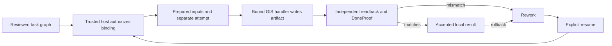

# Local engineering workflow

The [role registry](engineering-role-registry.json) names the engineering roles,
the skills they use and the artifacts they hand off. The [intent
compiler](../scripts/intent_router.py) supplies the reviewed task graph. The
[local controller](../scripts/engineering_workflow.py) binds it to actions that
the host provides as trusted Python callables.

## Contract

- Each binding supplies a command ID, prepared fixture inputs, a disjoint
  output group and an independent readback check for each acceptance criterion.
  The role profile follows the task risk and adds specialists when their
  relevant skills are present.
- A trusted host authorizer receives the plan fingerprint, revision, task,
  command, operation, declared effects and workspace for every dispatch.
  The host remains responsible for actual authority and sandbox isolation.
  The controller accepts local read/write effects for the explicitly bound
  handler. Command strings from plan data never select executable code.
- Attempts write into distinct directories within the prepared test run.
  Checkpointed events record task and attempt state. Independent readback and
  plan-bound DoneProof are required before a result can be accepted. Accepted
  dependency outputs are rechecked before running dependants.
- A mismatch sends the task to REWORK. Resume checks the original plan and
  binding against the checkpoint. Rollback invalidates the active result and
  preserves earlier attempts. Review a new plan and start a new run when the
  plan revision, inputs, expected results or permitted output scope changes.
- Runtime events use SEQUENTIAL_ROLE_SIMULATION and SAME_AGENT_REVIEW. The
  host records verified milestones in the existing [development
  journal](agent-development-journal-guide.md). Run checkpoints describe
  execution and do not replace the journal. V2 architectural roles (`engine-selector`,
  `clean-room-reviewer`, `license-auditor`, and profile `V2_ARCHITECTURE`) map
  explicitly into this registry without claiming multi-agent parallelism when
  executed sequentially by one session.



## Run the isolated terrain verification

Create an empty disposable project directory and run the following commands
from the suite checkout. Use the run path returned by prepare in each
subsequent command.

```powershell
python scripts/verify_engineering_workflow.py --project PATH prepare
python scripts/verify_engineering_workflow.py --project PATH --run "testing results/0001_Engineering-Workflow" initial
python scripts/verify_engineering_workflow.py --project PATH --run "testing results/0001_Engineering-Workflow" repair
python scripts/verify_engineering_workflow.py --project PATH --run "testing results/0001_Engineering-Workflow" rollback
python scripts/verify_engineering_workflow.py --project PATH --run "testing results/0001_Engineering-Workflow" resume
```

The first run purposely uses an incorrect vertical unit for the synthetic
planar DEM. Verification should reject its raster. The repaired run and the
run after rollback should both reproduce nine 45° cells and a NoData border.
Read WORKFLOW.json, per-attempt READBACK.json, DONEPROOF.json and slope.asc
inside the run directory. This is a local Python execution using an ASCII
fixture with declared metre units. Native agent-client dispatch, parallel
review and clean-machine installation require their own acceptance checks.
