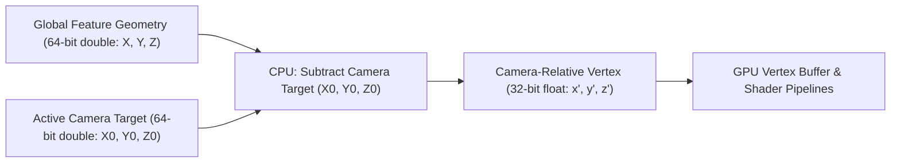

# Universal Native Desktop CAD/GIS & 3D Engine Architecture

## 1. Scope & Universality

This document establishes the universal engineering architecture for building high-performance native desktop CAD/GIS applications, 3D spatial workbenches, and geoprocessing software within the `GIS Development Skills` hub.

Whether constructing a multi-layer urban planner, an offline desktop globe (like `Z EARTH`), a 3D terrain flight explorer (like `Contour`), or a stormwater drainage designer (like `SmartGully`), every desktop geospatial tool must adhere to these unified standards for numerical precision, UI ergonomics, modularity, and rendering performance.

---

## 2. Engine Evaluation Tradeoff Matrix

Selecting a runtime engine for desktop CAD/GIS involves strict tradeoffs between mathematical precision, memory control, and visual fidelity.

| Architectural Dimension | Path A: C++20 + Qt 6 Widgets + Native Renderer (Production Standard) | Path B: Godot 4 .NET / C# (Interactive Prototyping Alternative) | Path C: Unreal Engine 5 (High-End Cinema Export Only) |
| :--- | :--- | :--- | :--- |
| **Numerical Precision** | **Full 64-bit Double Precision Native**. Sub-millimeter accuracy globally. | **Single-precision (32-bit float)** in default build; double precision requires custom engine compile. | **Large World Coordinates (LWC)** uses double precision transforms, but inner shaders use float. |
| **Coordinate Jitter** | **Zero Jitter**. Camera-relative rendering mathematically eliminates vertex instability. | **High Jitter** at coordinates > 100 km from origin unless custom localized origins are coded. | Minimal jitter with LWC, but high overhead. |
| **Memory & GC Pauses** | **Zero GC Pauses**. Deterministic C++ RAII memory allocation. | **GC Stutters**. C# Garbage Collector introduces frame drops during high-frequency mesh regeneration. | Deterministic C++ GC, but massive baseline memory consumption (> 2 GB RAM). |
| **Native GIS / CAD Libraries** | Direct C++ linking to GDAL, GEOS, PROJ, `earcut.hpp`, `Clipper2`, and OpenCASCADE. | Requires P/Invoke C# wrappers; marshaling overhead on million-vertex geometries. | Complex third-party C++ build pipeline; steep learning curve for spatial vector data. |
| **UI Ergonomics** | **Native Dark CAD UX**. Direct integration with `SARibbon`, `Qt-ADS`, and `QtPropertyBrowser`. | Game-oriented UI controls; difficult to replicate engineering docking and CAD ribbons. | Slate UI framework is game-focused; heavy and non-standard for multi-window engineering CAD. |
| **Distribution Footprint** | Compact installer (**~40–80 MB** packaged with shared Qt dynamic libraries). | Lightweight (**~60–100 MB** standalone binary). | Massive footprint (**> 5–15 GB** runtime engine footprint). |
| **Architectural Verdict** | **MANDATORY PRODUCTION STANDARD** for all engineering tools and apps. | **Permitted for rapid UI mockups and sandboxed game-like explorations**. | **Restricted strictly to offline cinema/animation video rendering**. |

### Lessons from Production Software & Prototypes
- **From `Z EARTH` (`D:\My Software\Z EARTH`)**: A desktop wrapper combining native UI with hardware-accelerated 3D viewports ensures offline independence, seamless KML/KMZ preservation, and zero cloud dependency.
- **From `FreeCAD` (`FreeCAD/FreeCAD`)**: The **Workbench Modularity Pattern** allows clean separation of concerns: core geometry is managed by an agnostic data model, while specialized workbenches (Roads, Buildings, Simulation, Utilities) dynamically register their ribbon tabs and tools.
- **From Interactive Prototype V2 (`Urban_Design_Studio_Professional_Workspace_V2.html`)**: Synchronized split-screen 2D/3D visualization significantly boosts user productivity by allowing simultaneous orthogonal drafting and spatial volumetric review.

---

## 3. Coordinate System & Numerical Precision Standards

### 3.1 The Large World Coordinate Problem
In projected GIS coordinate systems (such as UTM Zone 36N for Egypt/Middle East, or national grid systems), coordinates frequently exceed millions of meters:
- Easting: $X \approx 350,000.000\text{ m}$
- Northing: $Y \approx 3,450,000.000\text{ m}$

Standard IEEE-754 single-precision floating-point numbers (`float` 32-bit) allocate only 24 bits for the mantissa, yielding approximately **7 significant decimal digits**. When storing a coordinate like `3,450,000.5`, the minimum resolvable delta is:
$$\Delta x \approx 3,450,000 \times 2^{-24} \approx 0.205\text{ m}$$
This results in **severe vertex jittering, jagged line rendering, and violent Z-fighting** in GPU depth buffers.

### 3.2 Solution: Camera-Relative Rendering (Local Render Origin)
Every desktop GIS/CAD application developed under this framework must implement **Camera-Relative Local Origin Shifting**:



1. **Storage Layer**: All spatial geometry, node networks, and parcel boundaries are stored exclusively in 64-bit `double` coordinates, guaranteeing sub-millimeter precision ($< 0.001\text{ mm}$).
2. **Transformation Step**: In each frame before rendering, the current camera focus target $\vec{C}_0 = (X_0, Y_0, Z_0)$ is selected as the temporary local origin.
3. **Vertex Offset**:
   $$\vec{v}_{\text{local}} = \vec{v}_{\text{global}} - \vec{C}_0$$
4. **GPU Upload**: The offset $\vec{v}_{\text{local}}$ is cast to 32-bit `float` and uploaded to the GPU vertex buffers. Since values now range within hundreds of meters rather than millions, full 32-bit float precision ($< 0.0001\text{ mm}$) is preserved on screen.

---

## 4. Level of Detail (LOD) Rendering Architecture

To render massive spatial domains (> 50,000 buildings, 200 km of roads, terrain DEMs) at a constant 60 FPS, tools must implement a 4-tier Level of Detail hierarchy:

```
LOD 0: 2D Footprint ───────────────> Distance > 2,000 m (Flat vector polygon)
LOD 1: 3D Massing Box ─────────────> Distance 800 m – 2,000 m (Extruded volumetric box)
LOD 2: Architectural Typology ─────> Distance 200 m – 800 m (Textured facade & sloped roof)
LOD 3: Micro-Engineering ──────────> Distance < 200 m (Recessed windows, doors, street furniture)
```

- **LOD 0 (2D Floor Plan / Footprint)**: Evaluated at camera distances $> 2,000\text{ m}$. Features are rendered as flat colored vector polygons on the ground plane with zero 3D height extrusion.
- **LOD 1 (3D Volumetric Massing)**: Evaluated between $800\text{ m}$ and $2,000\text{ m}$. Polygons are extruded into simple textured 3D prisms (`height = num_floors * 3.5 m`). All internal courtyards are triangulated using `earcut.hpp`.
- **LOD 2 (Architectural Facade Typology)**: Evaluated between $200\text{ m}$ and $800\text{ m}$. Buildings receive parametric roof geometry (hip, gable, flat with parapet) and procedural facade textures based on the designated architectural style (e.g. Modern, Islamic, Neoclassical, Mediterranean).
- **LOD 3 (Micro-Engineering Detail)**: Evaluated at close range ($< 200\text{ m}$). High-resolution geometry is rendered: recessed window frames, balconies, curb bevels, individual roadway gullies, sidewalk pavers, trees, and street furniture.

---

## 5. Dark CAD Workspace & UI Ergonomics Standards

All desktop applications share a standardized Dark CAD User Interface designed for continuous engineering drafting without eye strain.

```
+-----------------------------------------------------------------------------------------+
| [Quick Access] New | Open | Save | Undo (Ctrl+Z) | Redo (Ctrl+Y) | Scale: [1:1000 v]    |
+-----------------------------------------------------------------------------------------+
| SARibbon: [Home/CAD]  [Roads & Transit]  [Buildings & Zoning]  [Simulation]  [AI Copilot]|
| +-------------------------------------------------------------------------------------+ |
| | Line | Poly | Arc | Circle | Snap: [x] End [x] Mid | Ortho [x] | Polar [x] | Offset | |
+-----------------------------------------------------------------------------------------+
| [Layer Tree]   | [Split Viewport - Synchronized 2D CAD / 3D Persp] | [Property Browser] |
| - Site (L0)    | +-----------------------+-----------------------+ | Type: Primary Road |
| - Roads (L1)   | |                       |                       | | Width: 24.0 m      |
| - Parcels (L2) | |   2D Metric CAD Plan  |   3D Perspective View | | Lanes: 4           |
| - Massing (L3) | |   [Lock: 1:1000]      |   [Sun: 14:30 Jun 21] | | Speed: 60 km/h     |
| - Utility (L7) | |                       |                       | | Setback: 3.0 m     |
|                | +-----------------------+-----------------------+ | [Apply Changes]    |
+--------------------------------------------------------------------+--------------------+
| [Command Line]: _LINE Specify first point: 350120.50, 3450210.00    | [AI Copilot Dock]  |
+--------------------------------------------------------------------+--------------------+
| Ready | EPSG:32636 | X: 350,120.50  Y: 3,450,210.00  Z: 124.50 m | Scale 1:1000 | [Minimap] |
+-----------------------------------------------------------------------------------------+
```

### 5.1 Palette Tokens
- **Canvas Drafting Background**: `#1e1e1e` (Neutral charcoal; prevents high-contrast glare).
- **Dock Panel Background**: `#252526` (Slightly elevated dark surface).
- **Active Tab & Hover States**: `#2d2d2d` with a `#007acc` (Engineering Blue) accent underline.
- **Panel Borders & Dividers**: `#3e3e42` (Subtle 1px boundary).
- **Vector Drawing Elements**: High-visibility drafting colors:
  - Active Geometry: `#ffffff`
  - Construction/Guide Lines: `#569cd6` (Cyan-blue)
  - Selected Highlights: `#ff9800` (Safety Orange)
  - Snapping Indicators: `#4ec9b0` (Mint Green)

### 5.2 Contextual Ribbon Navigation (`SARibbon`)
Ribbon tabs dynamically expose domain-specific tools:
1. **`Home / CAD`**: Core drafting (Line, Polyline, Arc, Circle, Rectangle), modification (Move, Copy, Rotate, Scale, Trim, Extend, Offset), dimensioning, and layer controls.
2. **`Roads & Transit`**: Parametric street alignments, cross-section assemblies (`Streetmix` style), intersections, roundabouts, and parking bays.
3. **`Buildings & Zoning`**: Site boundary setup, automatic parcel subdivision, building footprint extrusion, floor count adjustment, and architectural style assignment.
4. **`Simulation & Analysis`**: Astronomical sun/shadow positioning, stormwater D8 runoff and ponding detection, roadway gully spacing optimization, and SUMO traffic export.
5. **`AI Copilot`**: Natural-language spatial generation, design compliance checks, automated zoning audit, and master plan optimization.

### 5.3 Advanced Docking Panels (`Qt Advanced Docking System`)
Users can tear off any panel into floating windows, snap panels into multi-row tabs, or arrange side-by-side viewports across multiple physical monitors. The workspace layout state is automatically persisted in user preferences.

### 5.4 Dynamic Property Inspector (`QtPropertyBrowser`)
The property panel displays a hierarchical property tree that reflects the current viewport selection:
- Selecting a **Road** displays: Hierarchy Class (Primary/Secondary), Total Right-of-Way Width, Lane Count, Pavement Cross-fall (%), Sidewalk Width, Speed Limit.
- Selecting a **Building** displays: Use Type (Residential/Commercial/Mixed), Footprint Area ($m^2$), Floor Count, Gross Floor Area, Height ($m$), Architectural Style, Front/Side/Rear Setbacks.
- Selecting a **Stormwater Pipe** displays: Upstream/Downstream Invert Level ($m$), Diameter ($\text{mm}$), Slope (%), Flow Capacity ($L/s$), Connected Gully IDs.

### 5.5 Canvas Scale Locking & Viewport Precision (`LockCanvasZoom`)
Drafting requires exact, uncorrupted engineering ratios:
- **Predefined Metric Scales**: Quick-selection dropdown supporting standard engineering drawing scales:
  $$\text{1:500},\quad \text{1:1000},\quad \text{1:2000},\quad \text{1:2500},\quad \text{1:5000}$$
- **Scale Lock Toggle**: When locked, canvas zooming is frozen to prevent accidental scale corruption during drafting; panning remains fully active.
- **Minimap (Overview Map)**: An interactive thumbnail map in the corner displaying the global master plan extent and a highlighted bounding box representing the active viewport frame.

### 5.6 Dual Drawing Mode Engine
1. **CAD Precision Drafting Mode**:
   - Continuous live tracking of mouse cursor.
   - Interactive object snapping (Osnap) with geometric glyph markers (square for endpoint, triangle for midpoint, circle for center).
   - Polar tracking showing dotted reference lines at configured angle increments.
   - Command-line entry supporting direct metric offsets.
2. **GIS Semantic Attribute Mode**:
   - Every vector entity maintains a backing relational attribute record in memory.
   - Editing geometry automatically updates geometric attributes (Perimeter, Area, Length, Azimuth).
   - Topological validity checks prevent self-intersecting polygons or disconnected road centerlines.
