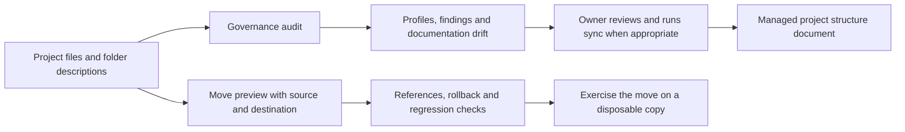

# Project governance and secure skill intake

This cross-cutting protocol extends the existing repository-wide skill
orchestration, GIS Development Router, Agent Development Journal,
GIS Security Guardian, DoneProof, remote sensing and code discovery skills.
It does not replace any existing specialist, manifest, code source or journal.

The implemented helper is scripts/project_governance.py. It uses Python's
standard library and does not download, install or execute external skills.

## Roles and ordered workflow

1. **Engineering Director / Intent:** identify the original user request,
   intended output, active reviewed plan/revision, protected data and acceptance
   criteria. Retrieve project context and compare with actual Git/files.
2. **Project Structure Engineer / Architect:** discover existing folders,
   solution/build files, module ownership and source/data boundaries. Classify
   each proposed restructure KEEP, EXTEND or REFACTOR. Seek user approval for
   consequential moves and protect existing project architecture.
3. **Toolchain Engineer:** discover available IDE, SDK, compiler, GUI designer,
   GIS engine and build tools, recording actual versions and authorized access.
   Do not assume software installed on a user PC is visible to a cloud agent.
4. **Domain experts and developers:** reuse existing relevant GIS specialists,
   vetted SDK references and libraries. Pass task IDs, input/output contracts,
   affected files and actual observed tool results between roles.
5. **Security and QA:** test from protected fixtures, read back outputs,
   inspect dependencies and permissions, prevent malicious skills and secrets
   exposure; use scientific checks for CRS, units, NoData, sensor, QA masks and
   spatial fidelity. T0/T1 does not establish native GIS T2-T4.
6. **Release and Journal:** build on the actual target platform, link native
   acceptance and security evidence, place user-test artifacts appropriately,
   update existing development journal and the compact context handoff.

Roles are responsibilities, not a claim that the host runs separate models.
The host still owns approvals, tool permissions, application execution and
native Windows/GIS tests.

## Root structure policy

The user project root receives AGENTS.md, PROJECT_STRUCTURE.md,
.gis-project-governance.json, plans/active/, plans/archive/, reports/,
context/CURRENT_HANDOFF.md, testing data/, testing results/,
New Skill/candidates/, New Skill/approved/, New Skill/promotion/, and
dist/user-testing/. The original project code and project-native layout
are never moved just to match a universal template.

| Location | Ownership and purpose |
| --- | --- |
| AGENTS.md | Additive project instructions, not an executable sandbox |
| PROJECT_STRUCTURE.md | Human-readable directory inventory and root-file descriptions |
| .gis-project-governance.json | Explicit purposes supplied for permanent folders |
| plans/active/ | Sequential drafts, original requests and plan status |
| plans/archive/ | Preserved plan history after evidence-linked closure |
| reports/ | Engineering and QA evidence and investigation |
| context/CURRENT_HANDOFF.md | Lightweight current state, not a replacement for the journal |
| testing data/ | USER OWNED fixtures; inputs are read-only unless separately authorized |
| testing results/ | GENERATED numbered test runs, screenshots, outputs and readback |
| New Skill/candidates/ | UNTRUSTED source metadata; never automatic skill activation |
| New Skill/approved/ | Only separately approved and legally reusable skill copies |
| New Skill/promotion/ | Review material for future integration into the main skill suite |
| dist/user-testing/ | Testable builds; do not call an unverified build stable |

The helper ensures the testing data folder exists even if empty. It creates
small .gitkeep placeholders and ignores actual user fixtures and generated
outputs in Git by default. Users must not put secrets or proprietary fixtures
in public commits. A run under testing results is labeled NOT RUN until a
real test has executed and evidence is recorded.

For fixture use, inspect formats, CRS/units, NoData, data provenance, sensor
metadata and expected values where relevant. Never write in place to testing
data. A run may use explicitly synthetic fixtures if clearly labeled, but
must report real-data tests as NOT RUN when no user data is present.

## Project preflight before development

Read the user's execution plan and identify the authorized project root. Before
implementation, present a checklist of the required runtimes, SDKs, packages
and visual or build capabilities. Show each tool's purpose, observation and
official source. Use the available editor for source work throughout the
project. A new tool or command can use the same editor or a terminal.

For a new project, take the target and package names from the plan. The
planned directory can be absent under an existing parent. For an existing
project, read the solution, project and supported dependency manifests under
its root. Review target frameworks and pins such as global.json. The report
extracts bounded literal dependency declarations. Restored or installed package
versions, dynamic requirements and remote URLs need independent inspection.

```powershell
python scripts/project_governance.py --project PATH preflight --mode new --target wpf --target-version 10.0 --require build
python scripts/project_governance.py --project PATH preflight --mode existing --require build
python scripts/project_governance.py --project PATH preflight --mode existing --project-file App.sln --require build --requires-tool visual-design=visual-studio
python scripts/project_governance.py --project PATH preflight --mode existing --tool-path 'vscode=C:\Custom Apps\VS Code\Code.exe'
```

Use `--project-file` to choose a project or solution relative to its root
when the scan sees independent build entries. `--requires-tool ACTION=TOOL`
binds a requirement to a specific action. `--required-tool TOOL` reports a
standalone requirement for a host task outside the listed actions. With
`--tool-path`, the check reads local file metadata and records verification
still needed for product identity and capability. An unreadable `global.json`
puts the dependent .NET build under review. Reuse the existing manifests,
framework and build process. For a supported SDK-style .NET
solution, consider [the matching .NET CLI](https://learn.microsoft.com/en-us/dotnet/core/tools/dotnet-build).
If Rider is already available, its [solution support](https://www.jetbrains.com/help/rider/Open_projects_and_solutions.html)
can be a candidate. Check project format, version, extensions and SDK support,
then test the same solution and its required behavior before adopting the
alternative. Keep ArcGIS and other special host requirements explicit.

When a required program is missing from the observed environment, pause its
dependent work. Show the official download page and a compatible installed
alternative when one is available. Ask the user to choose whether to install,
provide a path or change the reviewed approach. Continue independent source
review, documentation and approved work. A missing optional editor does not
hold the build. This command emits a read-only report and leaves approved
installation, build and runtime verification to the host.

## Skill readiness before use

Start with the minimum skills that cover the reviewed outcome. Name one accountable specialist and the specific responsibility of each supporting skill. An overlapping skill may provide a fallback if its requirements and evidence level match the work.

From the discovered `SKILL.md` and its references, identify the files, local commands, provider capabilities, versions, permissions and terms needed for the selected task. Report missing requirements for the dependent work and continue independent steps. Check external provenance through [Security Guardian](../skills/gis-security-guardian/SKILL.md) and the existing quarantine and review workflow before trusting executable attachments. Apply approved setup only for dependencies that are missing. Verify the actual version, provider schema and a small task-appropriate smoke test after setup.

The read-only `skill-preflight` command checks instruction files, attachments and candidate availability. A path match or host capability declaration provides a lead for the host to verify. Use `--require-file`, `--require-command` or `--require-capability` to record missing task-specific prerequisites discovered in any skill.

```powershell
python scripts/project_governance.py --project PATH skill-preflight --skill ui-ux-pro-max --require-file data/catalog-summary.json
python scripts/project_governance.py --project PATH skill-preflight --skill craft-anything --available-capability craft-mcp
python scripts/project_governance.py --project PATH skill-preflight --skill github-delivery --available-capability github-connector
```

| Selected workflow | Host check before relying on it |
| --- | --- |
| UI/UX Pro Max | Confirm the Python interpreter and the search script plus its selected dataset. Resolve file paths from the installed skill directory. |
| Craft Anything | Confirm an advertised tool for the authorized artifact inspection or validate the installed CLI and applicable toolset. |
| REA | Confirm the advertised or locally validated provider and the analysis engine actually needed for the authorized artifact. A Node or npm path alone gives no evidence that the provider is ready. |
| GitHub delivery | Check the installed Git client or the host's GitHub tooling for the selected action, repository and permissions. See [the delivery workflow](../PUBLISHING.md#approved-github-delivery). |

## Project-structure auditing

Every permanent directory must have a documented purpose. The generated
inventory marks unknown directories NEEDS_DESCRIPTION instead of inventing
responsibilities. Important root files are described separately. Dependency
folders, cache, temporary build outputs and raw test data are excluded from
recursive scans to limit unnecessary reading and private-data exposure.

The read-only audit includes evidence paths for source profiles such as WPF,
WinForms, Qt, QGIS, ArcGIS, web GIS and remote sensing. It can report identical
source bodies, a cycle in locally resolved imports or project references, and
missing literal .NET project references. Profiles can coexist in a single
project. Review these source hints against the project's actual build
configuration before making structural changes.

- **KEEP** means the audit found no missing required governance paths,
  undocumented directories, stale registrations or drift in managed documentation.
- **EXTEND** means at least one of those governance items needs review.
- **REFACTOR** is returned by an explicit move preview for a proposed rename
  or relocation. The preview includes forward and inverse paths, reference
  locations and the tests to run in an isolated working copy.

For automation, `audit --check` exits 1 when governance drift needs review and
exits 2 on errors. Plain `audit` retains the informational exit status.
Source findings and undecided root-file descriptions remain visible in both
modes. `sync` refreshes managed documentation and preserves handwritten
structure documents.

When code architecture genuinely needs refactoring, record impacted imports,
build definitions, Qt resource paths, WPF project references, test fixtures,
rollback and actual regression results before or after an approved migration.
The preview returns candidate references from bounded UTF-8 source inspection.
It skips linked paths, user test data, outputs and quarantined skills. Dynamic
imports, generated build inputs and resource conventions need separate review.
Check the scan limits and whether results were truncated before using a preview.
Apply a reviewed move separately and rerun the relevant project checks.



## Basic commands

From a checkout of the skill suite, run commands with an authorized target
project path:

    python scripts/project_governance.py --project PATH audit
    python scripts/project_governance.py --project PATH audit --check
    python scripts/project_governance.py --project PATH plan-move --from "src/old.py" --to "src/new.py"
    python scripts/project_governance.py --project PATH init
    python scripts/project_governance.py --project PATH sync
    python scripts/project_governance.py --project PATH register-folder --path "assets/icons" --purpose "Project UI icon files"
    python scripts/project_governance.py --project PATH new-plan --title "Map Engine" --request "Improve camera control and verify output"
    python scripts/project_governance.py --project PATH new-test-run --name "Raster NoData"
    python scripts/project_governance.py --project PATH test-data-inventory
    python scripts/project_governance.py --project PATH new-test-run --name "Raster NoData" --input "grid.asc" --expect "expected.json" --license-note "Synthetic project fixture"
    python scripts/project_governance.py --project PATH record-test-run --id 0001 --command "Raster test command already executed" --runtime "Named runtime and version" --semantics "CRS, units and NoData"
    python scripts/project_governance.py --project PATH close-plan --id 0001 --evidence "reports/map-engine.md"
    python scripts/project_governance.py --project PATH register-skill --name "Qt UI" --source "https://github.com/example/qt-skill" --purpose "Review Qt implementation" --revision "reviewed-sha"

The paths above are examples. The agent must use the real location of
scripts/project_governance.py in its accessible skill checkout; these commands
do not imply installation of the helper in every client.

**Status semantics:** new-plan creates a DRAFT, never authenticated approval.
close-plan checks existence of a nonempty project-local evidence file, then
archives it; presence of that file is NOT proof of successful GIS operation.
DoneProof and real tests are still required. new-test-run creates NOT RUN
placeholders and never changes the user fixture data.

### Prepared GIS test runs

Keep original inputs in testing data. Run the tool under test against the
selected copies in the numbered run's inputs directory. Write its results to
the returned artifact folder, which is the outputs directory in that run.
Prepare a project-relative expectation JSON before executing the operation.
The file has a checks array. Each entry has an artifact path relative to
outputs, a comparison of json or sha256, and an expected JSON value or
lowercase SHA-256. JSON values are compared exactly after parsing. Declare
rounding or tolerances in the GIS observation step before running the test.
See [a prepared expectation fixture](../fixtures/expected/p03-science.json).

The tool inventories bounded header or descriptor metadata from supported
ASCII grids, Landsat MTL and small JSON fixtures. TIFF and archive suffixes
are format hints. A native GIS readback establishes CRS, band arrangement,
pixel size, compression or NoData for a specific raster. Metadata fields
left unset require provider metadata or host verification.

Recording a result reopens the requested outputs and hashes the original
and copied fixtures again. RESULT.json retains expected and observed values,
hashes and failures. TEST_RUN.md links to that evidence. A record retains the
result of that invocation. After a failure, start a new numbered run to
retain the earlier receipt. Exit 1 means an observed mismatch or missing
output. Exit 2 means the request or record could not be processed.
The command field records what the host executed.

The helper appends a short managed rules section to existing AGENTS.md while
preserving original text; sync does not replace a user-authored structure
document. All mutations require appropriate project-user permission.

## External skill acquisition is a security boundary

First inspect current suite/installed skills and accepted local libraries.
If a real capability gap remains, search authoritative and community skill
repositories dynamically rather than using a fixed allowlist. Compare
functional match, duplicate coverage, license, maintainer, version,
dependencies and host requirements.

Keep candidate source information in New Skill/candidates; registration does
not fetch, install or execute code. Do not place this directory in any
automatically activated agent skill path. Pin a revision before integration.
Review the skill text and entrypoints through GIS Security Guardian plus
suitable tools (for example NVIDIA SkillSpector, Cisco Skill Scanner, dependency
and secret scanners) when available. Any scanner can miss threats.

Use an exact source revision and record the upstream license link and allowed
effects when registering a candidate. The planned effects describe its
requirements for later review. They do not grant permission.

    python scripts/project_governance.py --project PATH register-skill --name "Candidate" --source "https://example.invalid/pinned-source" --purpose "Required capability" --revision FULL_COMMIT --license MIT --license-evidence "https://example.invalid/pinned-license" --effect read
    python scripts/project_governance.py --project PATH review-skill --id 0001 --snapshot "candidate.zip" --sha256 EXPECTED_SHA256

The second command inspects a ZIP already supplied within the project. It
checks an explicit SHA-256, applies the archive metadata guard, and scans
bounded UTF-8 text for the repository's heuristic rules. It records executable
members, entrypoints, dependency manifests, and unmet metadata requirements.
No archive member is extracted. A small documentation-only candidate can
reach READY_FOR_MANUAL_REVIEW. Serious findings produce REJECTED_ISOLATED
and exit 1. Metadata gaps or other findings produce REVIEW_REQUIRED.
An invalid request or digest produces exit 2. The registry points to a
readable review receipt for each scan. All of these states leave the skill
inactive.

Executing or enabling an external skill requires separately authorized,
least-privileged and ideally isolated tests. Review redistribution rights
before copying any upstream bytes. Promote proven candidates using the
existing source intake, manifest, router and bilingual documentation workflow.
Do not duplicate skills merely because they have a different name.

Existing Anthropic, NVIDIA, Qt, Esri, remote sensing, GIS code discovery,
security and token optimization references remain in use. Catalog reference
status must not be misreported as installed or successfully tested.

## Token and memory policy

Use the existing Token Optimization Triad: read only relevant code ranges,
prefer surgical patches, compact excessive tool logs and keep verified
handoffs. Do not optimize away required security scans, scientific source
checks or native GIS tests. Resume by comparing context and journal records
against current files and source revision.

## Implemented vs planned

The current helper implements safe root bootstrap, directory registration,
a human-readable structure inventory, source profiles, drift checking,
read-only migration preview, draft numbered plans and evidence-linked
archival, fixture/output separation, numbered test-run placeholders and
candidate-only skill registration. It **does not yet** implement dynamic online
skill search, malicious-code scanning, IDE automation, toolchain probing,
remote runtime execution, multi-agent dispatch, automatic source restructuring
or native GUI acceptance. Those capabilities need separate host integration
and observed end-to-end tests before claims of completion.


## Read-only IDE and toolchain reconnaissance

Use scripts/toolchain_discovery.py from the actual accessible suite checkout:

    python scripts/toolchain_discovery.py --project PATH
    python scripts/toolchain_discovery.py --project PATH --native

The default mode checks source/build file patterns and PATH without launching
executables. On Windows, --native queries known installer locations and fixed
version commands for Visual Studio, .NET, Node and Qt, and reads QGIS/ArcGIS
file metadata. The .NET query separates SDK and runtime versions from optional
workloads. A denied query is recorded as unavailable. A file version records
installation metadata. Output paths are hidden unless --include-paths is passed.

The native inventory reports editors and designers in separate lists. It checks
standard VS Code, Antigravity, Rider and Qt Creator install locations, Qt
Designer in known Qt SDKs, and Qt Designer bundled with QGIS. For portable or
customized installs, confirm an executable's identity during host preflight.

Pass the required capability and existing project target to get an observed
shortlist. Use the version from the project when evaluating a build or designer.

```powershell
python scripts/toolchain_discovery.py --project PATH --recommend wpf --capability build --target-version 10.0
python scripts/toolchain_discovery.py --project PATH --recommend wpf --capability visual-design --target-version 8.0
python scripts/toolchain_discovery.py --project PATH --recommend qt-widgets --capability visual-design --target-version 6
```

The preview distinguishes installed-file metadata, a PATH match, an SDK query
and a capability that still needs verification. An observed candidate still
needs a real build, launch or project-specific GUI test when the task calls for
one. The command keeps the target stack. In an ArcGIS Pro SDK build, check the
local Pro version and the Esri-approved IDE and SDK for that release.

Prefer an applicable no-cost route. [.NET SDK](https://dotnet.microsoft.com/en-us/platform/free)
provides a no-cost CLI build path. VS Code can edit the source, with separate
[C# extension and C# Dev Kit terms](https://code.visualstudio.com/docs/csharp/cs-dev-kit-faq).
[Qt Creator and Qt Widgets Designer](https://doc.qt.io/qtcreator/creator-using-qt-designer.html)
serve Qt projects with the appropriate Qt kit and [edition terms](https://www.qt.io/development/tools/qt-creator-licensing).
[Rider's free license covers non-commercial use](https://sales.jetbrains.com/hc/en-gb/articles/18950890312210-The-free-non-commercial-licensing-FAQ).
Rider offers a [WinForms visual designer](https://www.jetbrains.com/help/rider/Working_with_Windows_Forms.html)
and [WPF XAML preview](https://www.jetbrains.com/help/rider/Settings_Tools_XAML_Preview.html).
Use [Visual Studio's WPF XAML Designer](https://learn.microsoft.com/visualstudio/ide/reference/xaml-designer?view=vs-2022)
with the matching workload and [.NET target](https://learn.microsoft.com/en-us/dotnet/core/porting/versioning-sdk-msbuild-vs).

Use `--prefer TOOL` to favor a compatible installed option. Supply
`--license-confirmed TOOL` only after confirming the terms cover the intended
use. The option is a caller declaration. Actual activation and rights remain
with the host and user.

Build, launch, IDE UI, and license checks have their own evidence. Prefer the
existing solution for maintenance. For a new test, use a locally installed
official template in a disposable project. Validate the build and actual app
separately. [WPF build and readback harness](../native_tests/README.md#windows-wpf-toolchain-acceptance)
