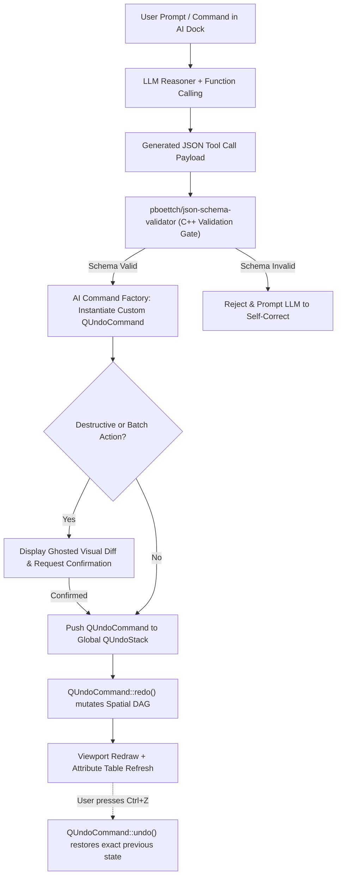

# Universal Reversible CAD/GIS AI Copilot Architecture

## 1. Executive Summary & Purpose

This document specifies the universal architectural standard for integrating an **autonomous AI Copilot** into desktop CAD/GIS applications, spatial workbenches, and geoprocessing software.

It establishes:
1. **The Reversibility Contract**: Mandatory `QUndoStack` / `QUndoCommand` encapsulation guaranteeing instant, clean `Ctrl+Z` undoability for every AI operation.
2. **Three-Tier Permission Architecture**: Clear separation of Query, Advisor, and Action privileges.
3. **Selection Context Awareness**: Real-time injection of viewport selection state into the LLM context.
4. **Strict C++ JSON Schema Validation**: Enforcing schema constraints via `pboettch/json-schema-validator` before passing tool calls to native C++ engine slots.
5. **Visual Diff Preview Gate**: Interactive ghosted overlays for batch or destructive spatial modifications.

---

## 2. The Reversibility Contract (`QUndoStack` & `QUndoCommand`)



### 2.1 The Core Invariant
> **No AI tool call, generative algorithm, or automated edit may directly mutate spatial entities, topology tables, or project documents. Every modification MUST be implemented as a concrete `QUndoCommand` subclass and pushed to the application's `QUndoStack`.**

### 2.2 C++ Implementation Pattern
```cpp
class AICityEditCommand : public QUndoCommand {
public:
    AICityEditCommand(SpatialDocument* doc, const QJsonObject& aiPayload, QUndoCommand* parent = nullptr)
        : QUndoCommand(parent), m_doc(doc), m_payload(aiPayload) {
        setText(QString("AI: %1").arg(aiPayload["action_description"].toString()));
    }

    void redo() override {
        // Execute forward modification: capture deleted entities and add new geometries
        m_snapshotBefore = m_doc->captureState(m_affectedUUIDs);
        m_doc->applySpatialDelta(m_payload["delta"]);
        m_doc->markDirty();
    }

    void undo() override {
        // Restore exact pre-modification geometry, attributes, and DAG relationships
        m_doc->restoreState(m_snapshotBefore);
        m_doc->markDirty();
    }

private:
    SpatialDocument* m_doc;
    QJsonObject m_payload;
    QList<QUuid> m_affectedUUIDs;
    SpatialStateSnapshot m_snapshotBefore;
};
```

### 2.3 User Experience Guarantee
If the AI copilot generates a road network, subdivides 50 parcels, and re-allocates building heights, the engineer can press **`Ctrl+Z`** once, and the entire operation is completely and instantly undone. Zero dangling vertices, zero corrupted layer tables, and zero topological orphans.

---

## 3. Three-Tier Permission Architecture

To ensure safety and build user trust, copilot actions are segmented into three operational tiers:

| Permission Tier | Operational Scope | Canvas Mutation | User Confirmation | Example Workflows |
| :--- | :--- | :--- | :--- | :--- |
| **Tier 1: Query** | Read-Only Inspection | **None (0%)** | Automated (Silent) | "What is the total Gross Floor Area?", "Calculate the average slope of Road 4", "How many parcels violate the 3m setback?" |
| **Tier 2: Advisor** | Diagnostic & Compliance | **None (0%)** | Emits Review Report | "Audit the master plan against Egyptian Building Law 119", "Check solar access for residential block B", "Find missing stormwater gullies". |
| **Tier 3: Action** | Generative & Editing | **Mutates DAG** | Required (Visual Diff) | "Subdivide Superblock 3 into 12 single-family lots", "Widen this street to 24m with a 2m median", "Align building heights to a 45-degree sky angle". |

---

## 4. Selection Context Awareness

To enable intuitive, natural dialogue (e.g. *"Make this road 4 lanes with a bike path"* or *"Increase the floors on these buildings to 5"*), the copilot continuously observes the active viewport selection:

```json
{
  "context_timestamp": "2026-11-19T04:15:00Z",
  "active_layer": "Road_Network",
  "selection_active": true,
  "selected_count": 1,
  "selected_entities": [
    {
      "uuid": "7c9e6679-7425-40de-944b-e07fc1f90ae7",
      "layer": "Road_Network",
      "type": "Collector_Street",
      "length_m": 420.50,
      "bounding_box": [350100.0, 3450150.0, 350520.5, 3450250.0],
      "attributes": {
        "name": "Al-Amal Boulevard",
        "current_width_m": 18.0,
        "lane_count": 2,
        "speed_limit_kmh": 50,
        "pavement_condition": "good"
      }
    }
  ]
}
```

When the user gives a command, the LLM prompt is augmented with this payload. The LLM targets the exact `uuid` directly, preventing ambiguity.

---

## 5. Strict C++ JSON Schema Validation (`pboettch/json-schema-validator`)

All tool calls emitted by the AI copilot are validated against rigid JSON Schema Draft 7 specifications using `pboettch/json-schema-validator` inside native C++ before touching the document model.

### 5.1 Road Cross-Section Modification Tool Schema
```json
{
  "$schema": "http://json-schema.org/draft-07/schema#",
  "title": "ModifyRoadCrossSection",
  "type": "object",
  "required": ["road_uuid", "total_width_m", "lanes", "sidewalk_left_m", "sidewalk_right_m"],
  "properties": {
    "road_uuid": {
      "type": "string",
      "format": "uuid"
    },
    "total_width_m": {
      "type": "number",
      "minimum": 6.0,
      "maximum": 80.0
    },
    "lanes": {
      "type": "integer",
      "minimum": 1,
      "maximum": 12
    },
    "lane_width_m": {
      "type": "number",
      "minimum": 2.75,
      "maximum": 4.5
    },
    "sidewalk_left_m": {
      "type": "number",
      "minimum": 1.2,
      "maximum": 15.0
    },
    "sidewalk_right_m": {
      "type": "number",
      "minimum": 1.2,
      "maximum": 15.0
    },
    "has_bike_lane": {
      "type": "boolean"
    },
    "median_width_m": {
      "type": "number",
      "minimum": 0.0,
      "maximum": 10.0
    }
  },
  "additionalProperties": false
}
```

### 5.2 Validation Protocol
If the model emits an invalid parameter (e.g. `total_width_m: -15` or an unlisted property), the C++ validator immediately returns a structured error:
```json
{
  "status": "VALIDATION_FAILED",
  "error": "Field 'total_width_m' must be >= 6.0, received -15.0. Additional property 'fly_drone' is not allowed.",
  "retry_allowed": true
}
```
The application state remains 100% clean, and the model receives feedback to correct itself.

---

## 6. Visual Diff Preview Gate

Before executing any Tier 3 action affecting more than a single entity, the host application enters **Visual Diff Mode**:
- **Existing Baseline Geometry**: Rendered in muted grey wireframe.
- **Proposed Additions**: Highlighted in vibrant **Green** (`#4ec9b0`).
- **Proposed Modifications**: Highlighted in vibrant **Orange** (`#ff9800`).
- **Proposed Deletions**: Highlighted in vibrant **Red** (`#f44336`).

A floating confirmation dialog displays summary metrics:
- Net Change in Road Surface Area: $+1,250\text{ m}^2$
- Net Change in Parcel Count: $+8\text{ parcels}$
- Net Change in Building Footprint Area: $-320\text{ m}^2$

Only when the user clicks **"Apply Changes"** (or presses `Enter`) is the `QUndoCommand` committed to the `QUndoStack`.
