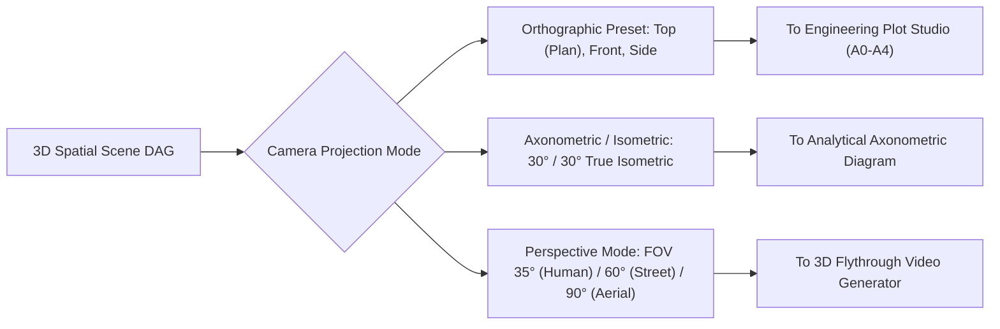

# Universal Desktop CAD/GIS Export & Plotting Studio

## 1. Executive Summary & Purpose

This reference specifies the comprehensive **Export & Plotting Studio** architecture for desktop CAD/GIS applications, geoprocessing tools, and spatial plugins within the `GIS Development Skills` hub.

Drawing directly upon local software innovations (`Smart Plot PDF` for batch true-scale drawing plotting and `Contour` for 3D flythrough terrain cameras), this document standardizes:
1. Multi-View Camera Presets (Orthographic, Isometric, Perspective).
2. 3D Flythrough Path Animation and High-Resolution Video Rendering.
3. True-Scale Engineering Plot Layouts (ISO A0–A4) with Title Blocks and Legends.
4. Interactive Before/After Split-Screen Comparison Sliders.
5. Vector & Semantic Lossless Data Roundtrips (GPKG, DXF, CityJSON, glTF, IFC 4.3).

---

## 2. Standard Camera Presets & Viewport Projections



### 2.1 Projection Types
- **Orthographic (Parallel Projection)**:
  - Top View (True Plan): Parallel ray projection along Z-axis. Strictly metric and measurable with drafting scale rules.
  - Front / Side Elevations: Evaluates vertical clearances, building heights, and sky-exposure plane compliance.
- **True Isometric ($30^\circ / 30^\circ$)**:
  - The coordinate axes $X, Y, Z$ are equally inclined to the screen plane ($120^\circ$ separation). Scale along all three axes is uniform ($1:1:1$), making distances directly measurable without perspective foreshortening.
- **Perspective Camera**:
  - Human Eye Level ($h = 1.70\text{ m}$, $\text{FOV} = 35^\circ$): Simulates pedestrian walking experience along sidewalks and plazas.
  - Urban Streetscape ($\text{FOV} = 60^\circ$): Captures street cross-sections and building street walls.
  - Aerial Drone ($\text{FOV} = 85^\circ – 90^\circ$): Wide-angle urban master plan overview.

---

## 3. 3D Flythrough Studio (`Contour` Standard)

Based on the flight camera architecture developed in `Contour` (`D:\My Software\Skills\contour`):

### 3.1 Spline Path Formulation
The flight trajectory is defined by a 3D Cubic Bezier Spline $\vec{P}(t)$ passing through user-placed waypoint nodes $\vec{W}_0, \vec{W}_1, \dots, \vec{W}_n$:
$$\vec{P}(t) = (1-t)^3 \vec{P}_0 + 3(1-t)^2 t \vec{P}_1 + 3(1-t) t^2 \vec{P}_2 + t^3 \vec{P}_3,\quad t \in [0, 1]$$
- **Target Tracking Mode**: The camera orientation can lock onto:
  1. Forward Tangent Velocity: $\vec{T}(t) = \vec{P}(t) + \frac{d\vec{P}}{dt}$ (Drone fly-forward view).
  2. Fixed Focal Landmark: $\vec{T}(t) = \vec{O}_{\text{landmark}}$ (Orbiting around a central civic plaza or tower).
  3. Dynamic Vehicle Pursuit: Following an agent vehicle in a SUMO traffic stream.

### 3.2 Video Encoding Pipeline
- **Frame Buffering**: Offscreen rendering at configurable resolutions ($1080\text{p}$, $1440\text{p}$, $4\text{K UHD}$) at $30\text{ FPS}$ or $60\text{ FPS}$.
- **Encoding Pipeline**: Streams raw RGB framebuffer surfaces into native hardware encoders (NVENC / Intel QuickSync) using `FFmpeg` or Qt Multimedia:
  - Container: MP4 (H.264 / H.265) or WebM (VP9).
  - Bitrate: $15–25\text{ Mbps}$ for artifact-free CAD line rendering.

---

## 4. True-Scale Engineering Plot Layouts (`Smart Plot PDF` Standard)

Drawing directly from the layout engine of `Smart Plot PDF` (`D:\My Software\Smart Plot PDF`):

### 4.1 ISO 216 Paper Format Standards
```
+---------------------------------------------------------------------------------+
| Sheet Border (Margin: Left 20mm for binding, Top/Right/Bottom 10mm)            |
| +-----------------------------------------------------------------------------+ |
| |                                                                             | |
| |                                                                             | |
| |                     CAD Viewport (Scale: 1:1000 Locked)                     | |
| |                                                                             | |
| |                                                                             | |
| |                                                                             | |
| |                                                                             | |
| +-----------------------------------------------------------------------------+ |
| | Coordinate Grid Ticks: 350,200 E | 350,400 E | 3,450,200 N | 3,450,400 N    | |
| +---------------------------------------------+-------------------------------+ |
| | Dynamic Legend:                             | Title Block (Cartouche):      | |
| | [===] Primary Arterial Road (24m)           | Project: Al-Amal Master Plan  | |
| | [---] Stormwater Pipe (DN 400)              | Client: Ministry of Housing   | |
| | [*]   Roadway Gully Inlet                   | Scale: 1:1000 | Date: 2026-11 | |
| | [###] Commercial Zone (FAR 3.5)             | Sheet: PL-01-A0 | Rev: r5     | |
| | Scale Bar: 0____25____50____100m  [North ^] | Consultant: Ahmad Ibrahim Geo | |
+---------------------------------------------------------------------------------+
```

### 4.2 Layout Architecture Rules
1. **Viewport Metric Scaling**:
   The zoom factor in the drawing layout window is mathematically locked to physical paper millimeters:
   $$\text{Zoom Factor} = \frac{1}{\text{Target Scale}} \times \frac{1000\text{ mm}}{1\text{ m}}$$
   For a $1:1000$ plot, $1\text{ mm}$ on paper equals exactly $1.0\text{ m}$ on the ground.
2. **Title Block (Cartouche)**:
   - Configurable metadata: Project Title, Sheet Title, Drawing Number, Date, Scale, Drawn By, Approved By, Revision History Table.
   - Consultant Logo vector embedding.
3. **Dynamic Elements**:
   - Graphic Bar Scale: Automatically rescales if the viewport scale is modified.
   - North Arrow: Automatically rotates to match viewport rotation angle.
   - Dynamic Legend: Extracts symbology only from vector layers currently visible inside the viewport frame.
4. **Pure Vector Output**:
   Using `QPdfWriter` with 1200 DPI vector geometry. Text, lines, and hatch fills remain crisp vectors at infinite zoom, with zero raster pixelation.

---

## 5. Interactive Before/After Split Slider

For environmental reviews and master plan presentations, the studio generates interactive split-screen views:
- **Left Side**: Baseline pre-development state (Satellite imagery from `ATIAF`, existing natural terrain, unpaved paths).
- **Right Side**: Proposed urban master plan (Parametric roads, 3D buildings, stormwater gullies, landscaped parks).
- **Interactive Control**: A draggable vertical divider allowing reviewers to swipe across the scene in both 2D map mode and 3D perspective mode.

---

## 6. Vector & Semantic Lossless Data Roundtrips

The studio enforces strict geometric fidelity across five standardized exchange formats:

| Format | Extension | Standard | Preserved Data & Attributes |
| :--- | :--- | :--- | :--- |
| **GeoPackage** | `.gpkg` | OGC Standard | 2D/3D vector layers, spatial indexing, complete attribute tables, CRS definition. |
| **AutoCAD DXF** | `.dxf` | Release 2018 | Layered 2D/3D polylines, hatches, dimensions, text labels, true-scale metric units. |
| **glTF 2.0 / GLB** | `.gltf`, `.glb` | Khronos Group | 3D triangulated meshes (`earcut.hpp`), PBR materials, LOD nodes, instanced trees. |
| **CityJSON** | `.json` | OGC Community | Semantic 3D city objects (Building, Road, PlantCover), LOD 1 & LOD 2 attributes. |
| **Open BIM** | `.ifc` | buildingSMART (IFC 4.3) | `IfcRoad`, `IfcBuilding`, `IfcDistributionElement` (utilities), parametric alignments. |
