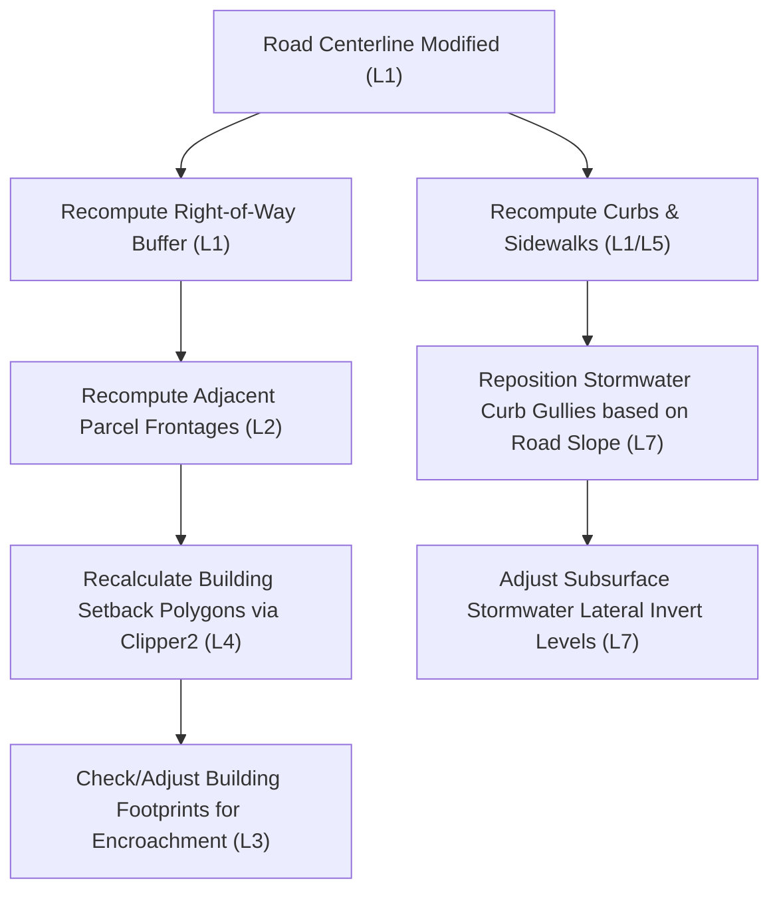

# Universal Parametric Spatial Data Hierarchy, Relational DAG Cascades & Geometry Modeling

## 1. Executive Summary & Purpose

This document specifies the universal spatial data architecture for parametric geospatial design, master planning, and engineering tool development within the `GIS Development Skills` hub.

It establishes:
1. The **8-Layer Spatial Stack** standardizing physical and legal layers from topography to subsurface utilities.
2. The **Relational Directed Acyclic Graph (DAG)** engine governing automatic cascade recalculation.
3. **Parametric Linear Networks** based on `ASAM OpenDRIVE` and `Streetmix` cross-section assemblies.
4. **Robust Planar Geometry** algorithms using `mapbox/earcut.hpp` (triangulation with interior holes) and `AngusJohnson/Clipper2` (polygon offsetting and booleans).
5. Four **Subsurface Infrastructure Networks** (sanitary, stormwater, water, electrical) bridging surface design with underground utilities based on real engineering patterns (`SmartGully`, `GeologicalCrossSectionToolbox`).

---

## 2. The 8-Layer Spatial Hierarchy Standard

Every project schema within this framework organizes entities across eight standardized, relational layers:

```
+-----------------------------------------------------------------------------------------+
| Layer 6: Micro-Architecture & Facades   | Windows, Balconies, 97 Styles, Roof Geometry  |
+-----------------------------------------------------------------------------------------+
| Layer 5: Landscaping & Public Realm     | Parks, Plazas, Sidewalks, Street Trees, Urban Furniture
+-----------------------------------------------------------------------------------------+
| Layer 4: Zoning, Land Use & Setbacks    | FAR, Front/Side/Rear Setbacks, Site Coverage  |
+-----------------------------------------------------------------------------------------+
| Layer 3: Building Footprints & Massing  | Extruded Massing, Floor Heights, Atriums/Holes|
+-----------------------------------------------------------------------------------------+
| Layer 2: Blocks & Parcel Subdivision    | Cadastral Lots, Frontages, Rights-of-Way (ROW)|
+-----------------------------------------------------------------------------------------+
| Layer 1: Road & Transportation Network  | Centerlines, Clothoids, Streetmix Cross-sects |
+-----------------------------------------------------------------------------------------+
| Layer 0: Site & Natural Topography      | Boundary, DEM Elevation Contours, Floodplain  |
+=========================================================================================+
| Layer 7: Subsurface Infrastructure (4x) | Gravity Sewer, Storm Gullies, Water, Electric |
+-----------------------------------------------------------------------------------------+
```

| Layer ID | Layer Name | Key Entity Types | Upstream Dependencies | Downstream Dependents |
| :--- | :--- | :--- | :--- | :--- |
| **Layer 0** | **Site & Topography** | Outer Boundary, DEM raster, Contour vectors, Flood zone, Water bodies. | None (Root) | Layer 1, Layer 2, Layer 7 |
| **Layer 1** | **Road Network** | Centerlines, Lane sections, Curbs, Intersections, Roundabouts. | Layer 0 (Topography) | Layer 2, Layer 5, Layer 7 |
| **Layer 2** | **Parcels & Blocks** | Superblocks, Cadastral Lots, Road Right-of-Way (ROW). | Layer 1 (Road Network) | Layer 3, Layer 4 |
| **Layer 3** | **Building Massing** | 2D Footprints, Volumetric Masses, Height, Floor Levels, Atrium Holes. | Layer 2 (Parcels) | Layer 4, Layer 6 |
| **Layer 4** | **Zoning & Setbacks** | Front/Side/Rear Setback Buffers, FAR, Building Coverage Ratio. | Layer 2, Layer 3 | Layer 3 (Validates/Constrains) |
| **Layer 5** | **Landscaping & Public** | Sidewalks, Bike paths, Green buffers, Plazas, Street trees, Furniture. | Layer 1, Layer 2 | Layer 6 |
| **Layer 6** | **Micro-Architecture** | Facade Textures, Fenestration patterns, Roof shapes (Gable/Hip/Flat). | Layer 3 | None (Visual leaf) |
| **Layer 7** | **Subsurface Utilities**| Sewer Gravity Pipes, Storm Gullies, Water Mains, Electric Duct Banks. | Layer 0, Layer 1 | None (Physical leaf) |

---

## 3. Relational Directed Acyclic Graph (DAG) Cascades

Spatial features are not static, isolated geometries. They are nodes in a **Directed Acyclic Graph (DAG)** of mathematical constraints. When a user or an AI copilot edits an upstream feature, the change automatically cascades through all dependent entities.



### 3.1 The Cascade Execution Algorithm
1. **Graph Topological Sort**: The dependency engine identifies all transitive dependents of the modified entity.
2. **Transactional Snapshot**: The initial state of all affected entities is recorded in memory.
3. **Downstream Propagation**:
   - `Road Axis Shift` $\rightarrow$ recalculates curb polylines via `Clipper2` offset.
   - `Curb Shift` $\rightarrow$ updates sidewalk geometry and positions of roadside tree nodes.
   - `ROW Expansion` $\rightarrow$ clips overlapping parcel frontages; updates parcel area and legal frontage length.
   - `Parcel Boundary Change` $\rightarrow$ recalculates setback polygon by deflating parcel by $(S_{\text{front}}, S_{\text{side}}, S_{\text{rear}})$.
   - `Building Check` $\rightarrow$ if building footprint violates new setback, either triggers automatic footprint trimming or emits an interactive CAD warning.
   - `Subsurface Adjustment` $\rightarrow$ shifts stormwater lateral pipes and roadside gullies to match the new curb alignment.
4. **`QUndoCommand` Encapsulation**: All modified entities are committed as a single composite command in `QUndoStack`. Pressing `Ctrl+Z` reverses the entire cascade simultaneously.

---

## 4. Parametric Linear Networks (ASAM OpenDRIVE & Streetmix)

### 4.1 Clothoid Transition Curves (ASAM OpenDRIVE)
Road centerlines must avoid instantaneous curvature jumps which cause unrealistic driving dynamics and geometric misalignment in CAD. The road alignment engine supports **Clothoid (Euler Spiral)** transition curves, where curvature $\kappa$ increases linearly with distance $s$:
$$\kappa(s) = \kappa_0 + c \cdot s$$
Where:
- $\kappa_0$ is initial curvature ($1/R_1$).
- $c$ is the clothoid change rate.
- $s$ is the arc length along the alignment.

### 4.2 Parametric Cross-Section Assemblies (`Streetmix` Standard)
Every road segment is parameterized by an array of lateral components centered on the alignment axis:
```json
{
  "road_id": "ROAD-AVE-01",
  "alignment_type": "clothoid_spline",
  "design_speed_kmh": 60,
  "cross_fall_percent": 2.0,
  "cross_section": [
    {"type": "sidewalk", "width_m": 3.0, "paving": "granite_tile"},
    {"type": "bike_lane", "width_m": 1.5, "paving": "red_asphalt", "buffer_m": 0.5},
    {"type": "curb", "width_m": 0.2, "height_m": 0.15},
    {"type": "vehicle_lane", "width_m": 3.5, "direction": "forward"},
    {"type": "vehicle_lane", "width_m": 3.5, "direction": "forward"},
    {"type": "median", "width_m": 2.0, "planting": "palms_and_shrubs"},
    {"type": "vehicle_lane", "width_m": 3.5, "direction": "reverse"},
    {"type": "vehicle_lane", "width_m": 3.5, "direction": "reverse"},
    {"type": "curb", "width_m": 0.2, "height_m": 0.15},
    {"type": "sidewalk", "width_m": 3.0, "paving": "granite_tile"}
  ]
}
```

### 4.3 Procedural Intersections & Roundabouts
- **T-Junctions & 4-Way Crossings**: Curbs are joined using circular transition arcs defined by standard corner curb return radii ($R = 6.0\text{ m}$ for residential, $R = 12.0\text{ m}$ for arterial transit).
- **Roundabouts**: Parametric circular central island radius ($R_{\text{island}} = 10\text{ m} - 25\text{ m}$), circulating lane width ($W = 8.0\text{ m}$), and tangential entry/exit splitter islands.

---

## 5. Robust Planar Geometry Algorithms

### 5.1 Polygon Triangulation with Interior Holes (`mapbox/earcut.hpp`)
In urban design and architecture, buildings and parcels frequently contain interior openings:
- Building courtyards and open-air atriums.
- Urban blocks enclosing central green parks or civic squares.
- Roundabout roadway surfaces enclosing non-traversable islands.

Standard ear-clipping algorithms fail on multi-ring polygons. The `earcut.hpp` engine operates on a flat array of vertex coordinates along with an array of hole starting indices:
```cpp
// Coordinate input: [x0,y0, x1,y1, ... outer ring ..., h0x,h0y, ... hole ring ...]
std::vector<std::vector<Point>> polygon;
polygon.push_back(outer_boundary_points);
polygon.push_back(interior_courtyard_points);

std::vector<uint32_t> indices = mapbox::earcut<uint32_t>(polygon);
// Returns clean 3D triangle vertex index triples: [i0, i1, i2, i3, i4, i5, ...]
```

### 5.2 Building Setbacks & Polygon Offsets (`AngusJohnson/Clipper2`)
To calculate buildable envelopes, `Clipper2` applies polygon deflation to parcel boundaries:
- **Front Setback**: Deflated along edges abutting the road right-of-way ($d = 3.0\text{ m} - 6.0\text{ m}$).
- **Side Setback**: Deflated along edges shared with neighboring parcels ($d = 1.5\text{ m} - 3.0\text{ m}$).
- **Rear Setback**: Deflated along the back edge of the lot ($d = 3.0\text{ m} - 5.0\text{ m}$).
- **Miter/Round Joint Controls**: Clean corner beveling prevents self-intersecting loops on acute lot angles.

---

## 6. Subsurface Infrastructure Modeling (4 Independent Networks)

Drawing directly on real-world engineering projects (`SmartGully`, `GeologicalCrossSectionToolbox`, and `Storm Drainage Calculation Dashboard`), underground utilities are modeled with strict hydraulic and clearance physics:

```
Surface:  ====================== Pavement Level ======================
Depth 0.8m:  [--- Electrical & Telecom Duct Bank (Rigid Concrete) ---]
Depth 1.2m:  [~~~~~~~~ Pressurized Water & Irrigation Main ~~~~~~~~~~]
Depth 1.8m:  [======== Gravity Stormwater Pipe & Roadway Gully ======]
Depth 2.5m:  [******** Gravity Sanitary Sewer (Invert Line) *********]
```

### 6.1 Gravity Sanitary Sewer Network
- **Physics**: Gravity flow with minimum self-cleansing velocity ($v \ge 0.6\text{ m/s}$) and minimum slope constraint ($S \ge 0.005$ or $0.5\%$).
- **Invert Levels**:
  $$z_{\text{invert, down}} = z_{\text{invert, up}} - (S \cdot L)$$
- **Manholes**: Located at all alignment turns, slope transitions, diameter changes, and at maximum spacing intervals of $50\text{ m}$.

### 6.2 Stormwater Roadway Drainage & Gully Spacing
Based on the verified calculations in `SmartGully`:
- **Gully Inlets**: Positioned in curb gutters at low points and along continuous longitudinal slopes.
- **Spacing Formula**:
  $$L = \frac{1000 \cdot Q_{\text{capacity}}}{C \cdot I \cdot W_{\text{catchment}}}$$
  Where:
  - $L$ is maximum spacing between roadway gullies ($\text{m}$).
  - $Q_{\text{capacity}}$ is inlet capture efficiency ($L/s$, typically $15–25\text{ L/s}$).
  - $C$ is composite pavement runoff coefficient ($0.85–0.90$).
  - $I$ is rainfall design intensity ($\text{mm/hr}$).
  - $W_{\text{catchment}}$ is the contributing pavement width draining to the curb ($\text{m}$).

### 6.3 Pressurized Potable & Fire Water Network
- **Physics**: Pressurized loop network ($P = 2.5 - 5.0\text{ bar}$) modeled with Hazen-Williams head loss constraints.
- **Appurtenances**: Gate valves at T-junctions, air release valves at high points, washouts at low points, and fire hydrants spaced every $100\text{ m}$.

### 6.4 Underground Electrical & Telecommunications Ducts
- **Physical Form**: Multi-way PVC conduit banks encased in lean concrete.
- **Separation Standards**:
  - Horizontal separation from wet utilities (water/sewer) $\ge 1.0\text{ m}$.
  - Vertical separation at crossing points $\ge 0.3\text{ m}$ (water placed strictly above sewer).

---

## 7. Open BIM Standard Interoperability (IFC 4.3)

All 3D spatial models support bidirectional export and import via `IfcOpenShell`:
- `IfcRoad`: Centerline, lane alignments, and pavement cross-sections.
- `IfcBuilding`: Massing, floor storeys (`IfcBuildingStorey`), and roof geometry.
- `IfcDistributionElement`: Underground pipe networks, manholes, and cable ducts.
- `IfcGeographicElement`: Topographic contours, parcel cadastral lots, and landscape trees.
