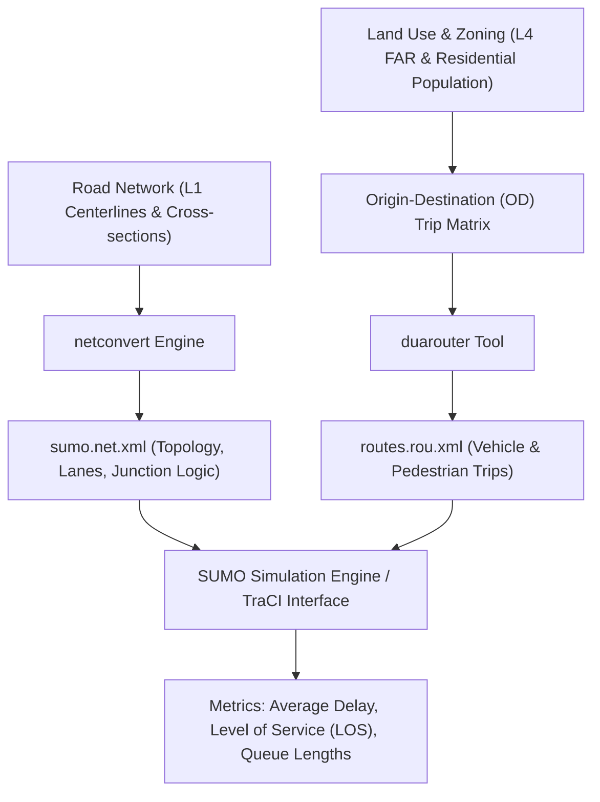

# Universal Multi-Physics Engineering Simulation Engines: Solar, Stormwater & Traffic

## 1. Executive Summary & Purpose

This document establishes the universal engineering specification for integrating **multi-physics simulation engines** into CAD/GIS applications, spatial plugins, and geoprocessing workflows.

It standardizes three essential engineering simulation domains:
1. **Astronomical Solar & Daylight Simulation**: Real-time solar position, sun-path tracking, and volumetric shadow casting (clean-room Ladybug Tools concepts).
2. **Stormwater Hydrology, D8 Runoff & Gully Spacing**: Catchment flow accumulation, depression ponding detection, and roadway drainage design based on verified patterns from `SmartGully` and `Storm Drainage Calculation Dashboard`.
3. **Microscopic Multimodal Traffic Simulation**: Roadway network XML export, turning lane connections, and vehicle/pedestrian dynamics via Eclipse SUMO and `A/B Street` principles.

---

## 2. Astronomical Solar Position & Real-Time Shadow Casting


### 2.1 Clean-Room Astronomical Solar Position Algorithm
To avoid GPL contamination from external engines, the solar position solver is derived directly from NOAA astronomical algorithms:

1. **Fractional Year ($\gamma$)**:
   $$\gamma = \frac{2\pi}{365} \left(\text{day\_of\_year} - 1 + \frac{\text{hour} - 12}{24}\right)$$
2. **Equation of Time ($E_t$ in minutes)**:
   $$E_t = 229.18 \left(0.000075 + 0.001868 \cos\gamma - 0.032077 \sin\gamma - 0.014615 \cos(2\gamma) - 0.040849 \sin(2\gamma)\right)$$
3. **Solar Declination ($\delta$ in radians)**:
   $$\delta = 0.006918 - 0.399912 \cos\gamma + 0.070257 \sin\gamma - 0.006758 \cos(2\gamma) + 0.000907 \sin(2\gamma) - 0.002697 \cos(3\gamma) + 0.00148 \sin(3\gamma)$$
4. **True Solar Time ($T_{\text{solar}}$ in minutes)**:
   $$T_{\text{solar}} = \left(\text{hour} \times 60 + \text{minute} + \frac{\text{second}}{60}\right) + E_t + 4 \times \text{longitude} - 60 \times \text{timezone\_offset}$$
5. **Hour Angle ($\omega$)**:
   $$\omega = \left(\frac{T_{\text{solar}}}{4} - 180\right) \times \frac{\pi}{180}$$
6. **Solar Altitude ($\alpha$) and Zenith Angle ($\theta_z$)**:
   $$\sin \alpha = \cos \theta_z = \sin \phi \sin \delta + \cos \phi \cos \delta \cos \omega$$
7. **Solar Azimuth ($\psi$)**:
   $$\cos \psi = \frac{\sin \alpha \sin \phi - \sin \delta}{\cos \alpha \cos \phi}$$
   *(Adjusted to $[0, 2\pi]$ based on sign of $\omega$).*

### 2.2 Volumetric Shadow Casting & Daylight Compliance
- **Sun Direction Vector**:
  $$\vec{L} = \begin{pmatrix} -\cos\alpha \sin\psi \\ -\cos\alpha \cos\psi \\ \sin\alpha \end{pmatrix}$$
- **Shadow Ray Projection**: For any 3D vertex $\vec{V} = (x, y, z)$ on a building roof or wall at height $h$:
  $$\vec{P}_{\text{shadow}} = \vec{V} - \frac{z - z_{\text{ground}}}{\sin\alpha} \vec{L}$$
- **Daylight Assessment**:
  - Minimum direct sunlight requirement for residential zones: $\ge 2.0\text{ hours}$ of direct sunlight on the winter solstice (December 21).
  - Open plaza solar comfort index: shading ratio calculation during summer peak hours (June 21, 12:00–15:00).

---

## 3. Stormwater Hydrology, D8 Runoff & Gully Spacing

Drawing on proven local engineering implementations (`SmartGully` and `Storm Drainage Calculation Dashboard`), hydrological modeling couples regional terrain watersheds with urban roadway curb drainage.

```
Terrain Watershed (DEM Grid) ───> D8 Flow Accumulation ───> Catchment Area (A)
                                                                │
Rainfall IDF Curves ────────────> Storm Intensity (I) ──────────┼───> Q = C * I * A
                                                                │
Pavement / Soil Cover ──────────> Runoff Coefficient (C) ───────┘
                                                                │
Roadway Gutter Flow ────────────> Gully Spacing Formula ────────┴───> Inlets & Pipes
```

### 3.1 Rational Runoff Method
Peak discharge $Q$ generated by a catchment lot or road segment is computed as:
$$Q = \frac{C \cdot I \cdot A}{360}$$
Where:
- $Q$ is peak runoff discharge ($m^3/s$).
- $C$ is dimensionless composite runoff coefficient:
  - Asphalt & Concrete Pavements: $0.85 – 0.95$
  - Building Roofs: $0.90 – 0.95$
  - Commercial / Dense Urban: $0.70 – 0.85$
  - Residential Parks & Lawns: $0.15 – 0.25$
- $I$ is rainfall intensity ($\text{mm/hr}$) determined from site Intensity-Duration-Frequency (IDF) curves for a selected design return period ($T = 5, 10, \text{or } 25\text{ years}$).
- $A$ is catchment surface area (hectares).

### 3.2 D8 Digital Elevation Hydrology & Ponding Analysis
Using high-resolution DEM grids (such as Copernicus DEM or localized survey points):
1. **D8 Flow Direction**: Flow from cell $(i, j)$ is routed to the steepest downward slope among its 8 neighbors:
   $$\text{Slope}_k = \frac{z_{i,j} - z_k}{d_k}$$
   Where $d_k$ is cell spacing ($1.0 \times \text{cell\_size}$ for cardinal directions, $\sqrt{2} \times \text{cell\_size}$ for diagonals).
2. **Flow Accumulation**: Each cell accumulates the total number of upstream contributing cells, automatically identifying natural thalwegs and primary surface flow channels.
3. **Depression Filling & Critical Ponding Detection**:
   - Pits (cells with no lower neighbor) are filled using the Planchon-Darboux algorithm.
   - The depth difference $\Delta z = z_{\text{filled}} - z_{\text{raw}}$ identifies critical flood-risk ponding depressions where water will accumulate if surface inlets are obstructed.

### 3.3 Roadway Gully Spacing Optimization (`SmartGully` Standard)
To prevent hazardous sheet flow across traffic lanes, curb gutters intercept water before spread width $T$ exceeds safety limits:
- **Modified Manning Gutter Flow (Izzard Formula)**:
  $$Q = \frac{0.375}{n} S_x^{5/3} S_0^{1/2} T^{8/3}$$
  Where:
  - $n$ is Manning roughness for concrete gutter ($0.013 – 0.015$).
  - $S_x$ is pavement cross-fall slope ($0.02 = 2.0\%$).
  - $S_0$ is roadway longitudinal slope ($m/m$).
  - $T$ is allowable gutter water spread width (typically $\le 1.5\text{ m}$ for primary roads).
- **Gully Inlet Spacing ($L$)**:
  $$L = \frac{Q_{\text{inlet\_capacity}}}{C \cdot I \cdot W_{\text{pavement}}}$$
  Spacing between gullies is constrained within statutory engineering limits ($15\text{ m} \le L \le 35\text{ m}$).

### 3.4 Pipe Hydraulics (Gravity Storm Pipes)
Pipe sizing and invert slope calculations:
$$v = \frac{1}{n} R^{2/3} S^{1/2},\quad Q_{\text{pipe}} = v \cdot A$$
- Maximum pipe filling ratio: $d/D \le 0.80$ (allowing 20% air head space).
- Self-cleansing velocity: $v_{\text{min}} \ge 0.75\text{ m/s}$.
- Maximum erosion velocity: $v_{\text{max}} \le 3.0\text{ m/s}$.

---

## 4. Microscopic Multimodal Traffic Simulation (Eclipse SUMO)

The parametric road network compiles directly to standardized XML input definitions for Eclipse SUMO:



### 4.1 SUMO Roadway Network Schema Export
1. **`nodes.xml` (Intersections & Terminal Points)**:
   ```xml
   <nodes version="1.0">
       <node id="J1" x="350100.0" y="3450200.0" z="120.0" type="traffic_light"/>
       <node id="J2" x="350450.0" y="3450200.0" z="118.5" type="priority"/>
   </nodes>
   ```
2. **`edges.xml` (Road Corridors & Lane Configurations)**:
   ```xml
   <edges version="1.0">
       <edge id="E1" from="J1" to="J2" numLanes="2" speed="16.67" priority="3">
           <lane index="0" width="3.5" allow="passenger bus"/>
           <lane index="1" width="3.5" allow="passenger"/>
       </edge>
   </edges>
   ```
3. **`connections.xml` (Junction Turning Movements)**:
   Defines allowed lane connections across intersections, prohibiting illegal left turns across median barriers and enforcing right-turn bypass lanes.

### 4.2 Traffic Demand Synthesis & Multimodal Routing
- **Trip Generation**: Residential zones generate morning outbound commuter trips based on unit counts ($0.8\text{ trips/household/peak\_hr}$); commercial zones generate inbound trips based on Gross Leasable Area (GLA).
- **Multimodal Simulation (`A/B Street` Integration)**:
  - Evaluation of dedicated bus rapid transit (BRT) lane priority.
  - Dedicated cycling network connectivity index: measuring percentage of master plan reachable via protected bike paths without mixing with high-speed vehicular traffic.
  - Pedestrian Level of Service (PLOS) based on sidewalk width and intersection crosswalk wait intervals.
