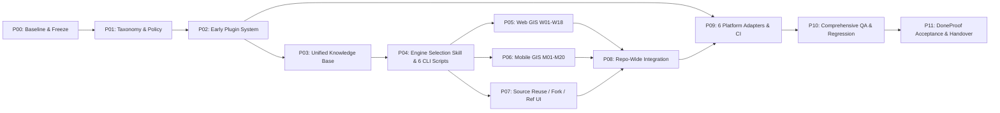

# GIS Development Skills — Implementation Roadmap (`P00–P11`) / خارطة التنفيذ التفصيلية

> **الحالة:** `DRAFT — خطة تنفيذ تفصيلية للمراجعة والاعتماد قبل بدء التعديلات`  
> **التاريخ:** 2026-11-25  
> **المرجع الأساسي:** [`01_Master_Integration_Plan.md`](01_Master_Integration_Plan.md)  
> **نموذج الأدوار الملزم في كل مرحلة:** `Programmer → Independent Reviewer → Tester → Acceptance`

---

## نظرة شاملة على التسلسل والتوازي / Execution Sequencing & Parallelism

> **سياسة التحديث التدريجي للبلجنز:** ابتداءً من إغلاق **`P02`**، تُختبر دورة البناء والمزامنة المحلية (`Update-All-Plugins.ps1`) على الحالة الراهنة أولًا، ثم تُحدَّث الحزم تلقائيًا عقب كل مرحلة معتمدة (`P03 → P08`) قبل التوسع الكامل للـ 6 محولات في **`P09`**.

---

## المرحلة P00: الجرد الكامل للمستودع والخطط الثلاث وتثبيت Baseline
- **الاعتماديات المانعة:** لا يوجد (نقطة البداية).
- **المدة التقديرية:** 1–2 يوم عمل (حزمة تدقيق وقراءة فقط).
- **الهدف (Objective):** تثبيت نقطة استعادة آمنة وحصر الحالة الحقيقية لملفات المستودع الراهنة (`git status`, commit SHA، الفهارس، المهارات الـ 35، الاختبارات الـ 75، خطط `0001` و`0006`، وأدوات الجهاز المحلي) دون حذف التعديلات القائمة غير المحفوظة أو مساس السجل `.agent-development-log/`.
- **شروط الدخول (Entry Criteria):**
  1. موافقة المالك على بدء التنفيذ المحدود بمرحلة التدقيق `P00`.
  2. التحقق من جذر Git الفعلي (`git rev-parse --show-toplevel`).
- **المخرجات (Deliverables):**
  1. `reports/plugin-lifecycle/000_BASELINE.md` (+ نسخة JSON مرافقة متوافقة مع بنية `reports/`).
  2. `plans/active/0007_Master-Integration/REQUEST.md`, `PLAN.json`, `STATUS.json` (توثيق رسمي لحوكمة المستودع دون تكرار `0006`).
  3. لقطة حالة `git rev-parse HEAD` (`42de4a246a2db1f7d33cc746da9cd3a0f1718a91` أو أحدث رأس معتمد)، وحصر حالة `working tree` وتعديلات المالك القائمة.
  4. مصفوفة عدادات خط الأساس الدقيقة (`skills`: 35، `project-catalog.json`: 193، `urban-design-source-registry.json`: 78، `free-geospatial-apis.json` الفعلي مقابل `repository-manifest.json`: 53، `gis-code-sources.json`: 17، `gis-code-recipes.json`: 5، `tests`: 75).
  5. تقرير جاهزية أدوات الجهاز المحلية (`toolchain_discovery.py` + فحص وجود `python`, `pwsh`, `node`, `git`, `codex`, `claude`, `agy`, `cursor`, `adb`, `flutter`, `xcodebuild` دون لمس جلسات أو توكنز).
- **خطوات التنفيذ المرتبة:**
  1. التحقق من جذر المستودع وعدم وجود قفل متعارض؛ حفظ `git status -s` و`git rev-parse HEAD`.
  2. تشغيل فحوص القراءة فقط الحالية (`validate_catalog.py`, `validate_api_catalog.py`, `validate_skill_pack.py`, `build_manifest.py --check`, `audit_skill_graph.py`, `security_audit.py --root .`, `python -m unittest discover -s tests -v`) لتسجيل `test baseline`.
  3. حصر `project-catalog.json` و`urban-design-source-registry.json` وتأكيد أرقام `UDS-LIB-004` (`DuckDB Spatial`) وبقية التداخلات الأولية.
  4. فحص `scripts/build_skill_bundle.py` وتحديد آلية تكامله مع `plugin-system/` لاحقًا.
  5. فحص جاهزية المنصات والـ CLI على جهاز المطور بالأوامر الرسمية (`--version` / `--help`) دون استخراج أسرار المتصفح أو ملفات الإعدادات الخاصة.
- **الأدوار (Roles):** Programmer (توليد لقطات الجرد) → Independent Reviewer (مطابقة العدادات مع الشجرة الحقيقية) → Tester (توثيق خط أساس الاختبارات القائمة) → Acceptance (تثبيت Baseline SHA).
- **معايير الخروج / DoneProof:**
  - حفظ `000_BASELINE.md` بجميع الأرقام المرصودة وSHA الفعلي.
  - عدم إجراء أي تعديل تخريبي على الملفات الراهنة.
- **مخاطر المرحلة:** تعارض مع التعديلات غير الملتزمة في `working tree` → *التخفيف:* عدم تشغيل `git clean` أو `git reset` أبدًا وحصر المخرجات في تقرير الجرد فقط.

---

## المرحلة P01: توحيد المتطلبات والتصنيف والمعمارية والسياسات / Taxonomy, Policy & Contracts
- **الاعتماديات المانعة:** `P00`.
- **المدة التقديرية:** 2–3 أيام عمل.
- **الهدف:** إرساء الدستور التصنيفي والسياساتي الموحّد لجميع الخطط الثلاث: إدراج سياسة البلجنز في `AGENTS.md`، توثيق التصنيف البرمجي الـ 24 ونماذج البناء الـ 11 والقدرات الذرية، تحديث `free-first-policy.md`، وترقية عقد المعمارية إلى `v2.0` دون كسر `v1.0`.
- **شروط الدخول:** إغلاق `P00`، وتوفر baseline اختبارات `validate_architecture_flow.py` و`intent_router.py`.
- **المخرجات:**
  1. تحديث `AGENTS.md` بإضافة قسم `Mandatory Plugin Lifecycle` (النص المعتمد من `Plugin Lifecycle §9`)، ومواءمة الإحالة في `CLAUDE.md` دون حذف أي قاعدة قائمة. *(تنفيذ أمر `./Update-All-Plugins.ps1` داخل السياسة يُربط بـ `P02` فور إنشائه حتى لا تُذكر أوامر غير موجودة قبل جاهزيتها)*.
  2. `references/engine-architecture-taxonomy.md`: القاموس الهندسي الموحد (24 نوعًا برمجيًا + `primary_role`/`secondary_roles` + قاعدة حسم التباس `UI.js` كبند `unresolved`) + مصفوفة الـ 11 نموذج بناء + 25+ نمطًا لفهم العامية العربية.
  3. `references/engine-capability-taxonomy.json`: المجموعات الـ 11 (>70 capability ID ذرية، مرادفات عربية/إنجليزية، درجات دعم `unknown..verified-for-target`، ودرجات ادعاء `unresolved..target-verified`).
  4. `references/build-vs-reuse-policy.md`: خوارزمية قرار «البناء مقابل إعادة الاستخدام»، أولويات الحلول، شروط توثيق `ADR` عند التطوير الجديد، وحالات منع الاستبدال.
  5. تحديث `references/free-first-policy.md`: فصل الدرجات الـ 9 للمجانية (`free-of-charge` vs `open-source` vs `free-tier` vs `commercial`) وبوابات تكلفة التشغيل والخدمات والبيانات.
  6. تحديث `references/ui-engine-architecture-contract.md` + `schemas/architecture-v2.schema.json`: إضافة حقول `v2.0` (`intent`, `reference_products`, `source_base`, `ui`, `components`, `capability_requirements`, `feature_inventory_ref`, `command_mapping_ref`, `flow_spec_ref`, `preserved_invariants`, `license_policy`, `decision_ref`) مع حفظ validator الخاص بـ `v1.0` كاملًا دون كسر.
- **خطوات التنفيذ المرتبة:**
  1. إنشاء مجلد `schemas/` وتوثيق مخطط `architecture-v2.schema.json`.
  2. تحديث `ui-engine-architecture-contract.md` وتطوير اختبارات التوافق العكسي لـ `v1.0` (`E23`, `E24`).
  3. كتابة `engine-architecture-taxonomy.md` و`engine-capability-taxonomy.json` و`build-vs-reuse-policy.md` وتحديث `free-first-policy.md`.
  4. تجهيز مسودة إضافة `AGENTS.md` و`CLAUDE.md` وتنسيقها مع قواعد المشروع الـ 97 القائمة.
- **الأدوار:** Architect/Programmer → Independent Reviewer (التحقق من عدم وجود تعارض مع `v1.0` و`AGENTS.md`) → Tester (تشغيل `validate_architecture_flow.py` واختبارات التوافق) → Acceptance.
- **معايير الخروج / DoneProof:** نجاح جميع اختبارات `v1.0` القائمة (`test_engine_architecture_migration` لـ `v1` + `validate_skill_pack.py`), واكتمال تصنيف الكيانات الـ 24 ونماذج البناء الـ 11.
- **مخاطر المرحلة:** `RISK-25` (كسر `validate_architecture_flow.py` عند الترقية لـ `v2.0`).

---

## المرحلة P02: تأسيس نظام البلجنز والتغليف والمزامنة المبكر / Early Plugin Lifecycle Engine
- **الاعتماديات المانعة:** `P00`, `P01`.
- **المدة التقديرية:** 3–4 أيام عمل.
- **الهدف:** بناء منظومة `plugin-system/` المبكرة واختبارها على **الحالة الراهنة للمستودع** قبل التوسعات الكبرى في المعرفة والويب والموبايل، بالتكامل مع `scripts/build_skill_bundle.py`.
- **شروط الدخول:** إغلاق `P01` وموافقة المالك على قواعد `.gitignore` وعزل ملفات المالك الخاصة خارج Git.
- **المواصفة التفصيلية لبنية `P02`:**
  - **هيكل `plugin-system/` المطلوب:**
    - `plugin-system/README.md` و`plugin-system/policy/DEVELOPMENT_LIFECYCLE.md`
    - `plugin-system/config/platforms.json` (سجل عام بدون أسرار أو مسارات شخصية؛ يحدد ID ومجلد الناتج وadapter وأنواع المحتوى ودعم verify/sync/release)
    - `plugin-system/config/source-map.json` (خريطة المسارات الفعلية من `P00`)
    - `plugin-system/config/plugin-sync.config.json` (افتراضات آمنة: `autoBuildAfterDevelopment: true`, `autoSyncLocal: true`, `autoOwnerRemoteUpdate: false`, `autoPublicPublish: false`)
    - `plugin-system/config/owner-config.example.json` (أمثلة آمنة فقط)
    - `plugin-system/schemas/` (مخططات platform manifest وتقارير المزامنة)
    - `plugin-system/core/` (inventory, SHA-256 content+path+template hashing, wrapper حول `scripts/build_skill_bundle.py`, clean staging, deterministic ZIP builder, parity reporter, validators)
    - `plugin-system/sync/` (مزامنة محلية مقفولة الصلاحيات مع rollback وحماية stale lock)
    - `plugin-system/release/` (تحضير مخرجات الإصدار فقط دون نشر تلقائي)
    - `plugin-system/adapters/` (عقد الـ 11 دالة الموحد مع adapter أولي لـ `portable` ومستوعب جاهز للـ 6 منصات ليُستكمل اختبارها المتقدم في `P09`)
    - `plugin-system/hooks/` (حلقات تحقّق اختيارية للمطورين: Git pre-commit/pre-push opt-in)
    - `plugin-system/tests/`
  - **جذر المستودع:** `VERSION` (SemVer مبدئي متسق مع `0.3.5` أو ما يعتمده المالك)، `Update-All-Plugins.ps1` & `Update-All-Plugins.bat`، `Update-My-Platforms.ps1` & `Update-My-Platforms.bat`، مجلد المخرجات `GIS-Development-Skills-Plugins/` (`README.md`, `index.json`, `portable-agent-plugin/` + هياكل المنصات الـ 6 الأولية)، ومجلد `reports/plugin-lifecycle/`.
  - **مواصفة `Update-All-Plugins.ps1` والأكواد الخروجية:**
    - يدعم الأعلام: `-CheckOnly`, `-BuildOnly`, `-Status`, `-Force`, `-Platform <list>`, `-Rollback -Version <ver>`, `-PrepareRelease`, `-Publish` (مقيد بموافقة).
    - أكواد الخروج الرسمية: `0` (نجاح كامل)، `2` (فشل build/validation)، `3` (مزامنة محلية جزئية مع rollback للمتضرر)، `4` (إجراء خارجي/موافقة مطلوبة)، `5` (قفل مشروع/تكوين غير صالح).
    - استدعاء منظم من `.bat` يحافظ على `exit code` دون تجاوز `ExecutionPolicy` قسريًا.
  - **عزل الأسرار و`.gitignore`:** عزل `owner-config.json` في `%LOCALAPPDATA%\GIS-Development-Skills\PluginSync\`، وحظر `/.plugin-local/`, `/.plugin-secrets/`, `**/owner-config.local.json`, `**/credentials.local.json`, `**/.env*` (مع استثناء `!/plugin-system/config/owner-config.example.json`)؛ بالإضافة لسياسة عدم تتبع ملفات ZIP الضخمة في Git (إبقاؤها في `artifacts/` المستبعدة محليًا وإتاحتها عبر CI artifacts/Releases) مع الاحتفاظ بالحزم المفكوكة اللازمة للـ Marketplace فقط.
- **خطوات التنفيذ:**
  1. تحديث `.gitignore` وإنشاء `VERSION`.
  2. بناء `plugin-system/core/` مع الاستفادة من منطق allowlist وchecks داخل `scripts/build_skill_bundle.py`.
  3. تطبيق `Update-All-Plugins.ps1/.bat` و`Update-My-Platforms.ps1/.bat` وقفل التنفيذ ذي الـ timeout.
  4. تنفيذ البناء التجريبي الأول على المستودع الحالي وتوليد `reports/plugin-lifecycle/001_PLUGIN_BOOTSTRAP.md/.json`.
  5. تشغيل اختبارات `T01–T16` و`T25` و`PL-SECURITY-*` (لا symlinks، لا path traversal، لا أسرار في ZIP أو `git ls-files`، فحص مسارات Windows العربية/المسافات، no-op skip، وreproducibility).
  6. إلحاق المرجعية النهائية للأمر الفعلي في `AGENTS.md` وتحديث `PROJECT_STRUCTURE.md`.
- **الأدوار:** Programmer → Independent Reviewer (أمني + معماري) → Tester (اختبارات الوحدة + فحوص `git check-ignore`) → Acceptance.
- **معايير الخروج / DoneProof:** بناء حتمي متطابق SHA-256 لنفس المصدر، صفر أسرار، نجاح التحديث على الوضع الحالي للمستودع، واجتياز `T01–T16`.

---

## المرحلة P03: تطوير قاعدة المعرفة الموحدة وسجلات المحركات والمكتبات / Unified Knowledge Base & Profiles
- **الاعتماديات المانعة:** `P00`, `P01`, `P02`.
- **المدة التقديرية:** 4–5 أيام عمل.
- **الهدف:** بناء قاعدة معرفة موحدة غير مكررة للمحركات والمكتبات والأطر والمصادر الخارجية والأدوات الهندسية ومزودي البيانات، مربوطة مركزيًا بـ `project-catalog.json`.
- **المخرجات:**
  1. ترحيل متوافق عكسيًا لـ `references/project-catalog.json`: إضافة `project_id` ثابت لكل من الـ 193 سجلًا القائمة + إدراج المستودعات الجديدة من V2 (§9، §23، §25) وr3 (§5–§10) الموثق روابط GitHub لها ضمن `URL_PATTERN` (دون تكرار URLs).
  2. إصلاح الخلل في `references/urban-design-source-registry.json`: تصحيح `UDS-LIB-004` (`DuckDB Spatial`) إلى `https://github.com/duckdb/duckdb-spatial` في ملف القدرات مع حفظ `duckdb/duckdb-skills` في سجل المهارات الخارجية، ومراجعة حقول `security_rating: safe` وتصحيح غير المدقق منها.
  3. إنشاء `references/engine-capability-profiles.json` + `schemas/engine-capability-profile.schema.json`: ربط كل تقنية بالمعرف `project_id`، الأدوار (`primary_role`, `secondary_roles`)، المنصات (`desktop/windows/linux/macos/web/android/ios`)، أنماط الدمج، القدرات الذرية (`capabilities`)، علاقات التبعية (`provides/requires/wraps/binds/conflicts/alternative-to`)، الرخصة (`spdx_hint`, `status`)، الأمان والتكلفة؛ بحيث تسجل كل مكتبة **مرة واحدة فقط** عبر المنصات.
  4. إنشاء `references/technology-compatibility.md` (تعارضات التراخيص، GPL/LGPL/MIT/Apache/Commercial، ABI/x64/ARM64، WebGL/WASM).
  5. إنشاء `references/engine-discovery-sources.json` (مصادر البحث المستمر الـ 13 في V2 §9.9: OSGeo, OSGeoLive, GDAL ecosystem, awesome-gis, PyPI, conda-forge, npm, NuGet, crates.io, Maven, OGC/EPSG/STAC, SPDX/OSI, OSV/Scorecard/CycloneDX/GH Advisories).
  6. إنشاء `references/external-agent-skills-registry.json`: حجر وتوثيق جميع مصادر المهارات الخارجية الواردة في V2 §26 (36 مصدرًا) وr3 §13 (15 مصدرًا) مع تكامل سجلات `0006/SOURCES.md` و`New Skill/` تحت الحالة الصارمة `candidate-review-only` / `reference-only` ومراجع `NVIDIA/SkillSpector` و`cisco` و`pinned commit/license` دون تثبيت تلقائي.
  7. إدراج جدول الأدوات الهندسية الـ 45 (V2 §27) والروابط المرجعية غير GitHub عبر حقول `official_docs` في ملفات القدرات دون كسر `URL_PATTERN` لـ `project-catalog.json`.
  8. تحديث حزم البلجنز محليًا في نهاية المرحلة (`Update-All-Plugins.ps1 -BuildOnly`).
- **خطوات التنفيذ:** كتابة سكربت ترحيل حتمي مؤقت (أو تحديث نظيف) ← فحص URL dedup ← إصلاح `DuckDB Spatial` ← بناء `engine-capability-profiles.json` ← بناء `external-agent-skills-registry.json` ← تشغيل `validate_catalog.py` و`audit_license_catalog.py` وتدقيق المخطط ← تحديث حزم البلجنز.
- **الأدوار:** Source Researcher & Knowledge Architect (Programmer) → Security/License Reviewer → Tester → Acceptance.
- **معايير الخروج / DoneProof:** صفر أخطاء في `validate_catalog.py` و`audit_license_catalog.py`، اختفاء رابط `duckdb-skills` الخاطئ من `DuckDB Spatial`، صفر URLs مكررة، تغطية جميع فئات القدرات الـ 11، وتحديث الحزم المحلية بنجاح.

---

## المرحلة P04: تطوير مهارة اختيار المحركات والسكربتات الستة / Engine Selection Skill & CLI Tools
- **الاعتماديات المانعة:** `P01`, `P03`.
- **المدة التقديرية:** 4–5 أيام عمل.
- **الهدف:** إنشاء المهارة المستقلة `skills/geospatial-engine-selection/SKILL.md`، وبناء واختبار السكربتات الستة في `scripts/`، وقوالب التوصية والـ ADR.
- **المخرجات والمواصفة الهندسية للسكربتات الستة:**
  1. **`skills/geospatial-engine-selection/SKILL.md`:** ملف مهارة مركّز (≤180 سطرًا) يشمل الواجهة المعيارية YAML، المسؤوليات الـ 10، مسارات التفعيل، خطوات العمل التسلسلية، حدود النطاق، وروابط Progressive Disclosure للمراجع والأدوات.
  2. **`references/engine-comparison-guide.md`:** بروتوكول المقارنة المعيارية، الأوزان الافتراضية الـ 7 (`25+20+15+15+10+10+5=100`)، مقياس `0–5`، جدول المقارنات النوعية الـ 10 (`V2 §10.3`)، وبروتوكول Benchmark (`V2 §32.1`).
  3. **`scripts/engine_repo_metadata.py`:** استعلام GitHub API للقراءة فقط (`api.github.com/repos/{owner}/{repo}`)؛ التحقق regex من الهوية؛ تعطيل `HTTPRedirectHandler` (`NoRedirect`)؛ حد قراءة 1MB؛ timeout 12s؛ التعامل مع `403/429/Retry-After` وcaching اختياري؛ إرجاع `state: metadata-only` دون اعتبار `license_hint` مراجعة قانونية. (يُختبر بـ mocked HTTP server لاختبار redirects/timeout/oversize/bad JSON/403).
  4. **`scripts/discover_engines.py`:** محرك اكتشاف حتمي (Offline-first) يقرأ `project-catalog.json` + `engine-capability-profiles.json` + `engine-capability-taxonomy.json` ويعيد استخدام بحث `search_catalog.py`؛ يدعم البحث متعدد اللغات (مرادفات عربية/إنجليزية)، التصفية بـ `--capability`, `--platform`, `--language`, `--license`, `--role`, `--format json|markdown`؛ لا يثبت شيئًا ولا يتصل بالشبكة تلقائيًا.
  5. **`scripts/compare_engines.py`:** تطبيق `hard_gate(candidate, required_caps, free_only=True)` (`rejected` vs `needs-evidence` vs `eligible`) ودالة `evaluate` / `rank_candidates` الموزونة؛ يمنع فوز أي مرشح `rejected` أو ناقص الدليل حتى لو ارتفعت نقاطه؛ مخرجات متطابقة لنفس المدخلات.
  6. **`scripts/recommend_stack.py`:** يولد خطة الـ Stack الكاملة (10 عناصر إلزامية حسب `V2 §18`) تتضمن المكونات المتعددة وتكاملها وعقود `DatasetRef/FeatureIdentity/RasterRef`، متطلبات المطور مقابل المستخدم النهائي، خطة PoC، الـ ADR، وحدود `NOT RUN` (أو يشرح الفجوة عند غياب مرشح مؤهل).
  7. **`scripts/validate_engine_profiles.py`:** يتحقق من `engine-capability-profile.schema.json`، ومرجعية كل `project_id` في `project-catalog.json`، وصحة capability IDs ضد `engine-capability-taxonomy.json`، ومنع التبعيات الدائرية، ومنع وسم `verified-for-target` بدون `evidence_refs`.
  8. **`scripts/inventory_ui_actions.py`:** جرد ثابت آمن لملفات `.ui` (`inspect_qt_ui`): رفض path traversal وsymlinks خارج الجذر، حد ملف 5MB، رفض `<!DOCTYPE`/`<!ENTITY`، استخراج `QAction` وshortcuts وtooltips و`addaction` placements، ووسم `dynamic_actions_verified: false` و`handlers_verified: false`.
  9. **توسعة `skills/gis-code-discovery/SKILL.md` و`scripts/gis_code_discovery.py`** لربط اكتشاف الوصفات بقدرات المحركات دون تكرار، وإنشاء القوالب الخمسة في `templates/` (`ENGINE_EVALUATION_REPORT.md`, `TECHNOLOGY_SELECTION_REPORT.md`, `ARCHITECTURE_DECISION_RECORD.md`, `SOURCE_FORK_FEATURE_INVENTORY.md`, `REFERENCE_UI_COMMAND_MAPPING.md`)، ومخططات `schemas/{engine-selection-request, engine-selection-report}.schema.json`.
  10. تحديث حزم البلجنز محليًا (`Update-All-Plugins.ps1`).
- **الأدوار:** Engine Specialist & Programmer → Independent Reviewer → Tester (اختبارات الوحدة + `tests/test_engine_profiles.py`, `test_engine_selection.py`, `test_engine_compatibility.py`, بالإضافة إلى حالات `E01–E40` القابلة للأتمتة على المستوى T0/T1) → Acceptance.
- **معايير الخروج / DoneProof:** عمل جميع السكربتات الستة دون أخطاء، اجتياز اختبارات الـ hard gate والحالات السلبية والمدخلات العربية وحتمية المخرجات، واجتياز `build_skill_bundle.py`.

---

## المرحلة P05: تطوير Web GIS الشامل / Web GIS Expansion (`W01–W12`, `WEB-01..WEB-18`)
- **الاعتماديات المانعة:** `P03`, `P04`.
- **المدة التقديرية:** 4–5 أيام عمل *(متوازية مع التخطيط الأولي لـ `P06` بعد استقرار `P04`)*.
- **الهدف:** تنفيذ مسار الويب الكامل من `Web_Mobile_r3` ودمج مهام `0006` (`T1–T3`) ومهام الويب (`T16–T25`) مع ربطها بـ `geospatial-engine-selection`.
- **المخرجات والمحتوى:**
  1. تحديث `skills/geospatial-web-mapping/SKILL.md` مع Progressive Disclosure ليربط بنظام اختيار المحركات ومراجع الويب دون تضخيم `SKILL.md`.
  2. إنشاء/تحديث المراجع المتخصصة تحت `references/`:
     - `web-gis-products-map.md` (الأنواع `W01–W12` + الطبقات المنطقية الثمانية + جدول قرار التقنية من 16 شرطًا و12 معيارًا كميًا)
     - `web-gis-architecture-selection.md` (أطر الويب `r3 §5.1` الـ 26، المسارات الـ 17، محركات الـ 2D الـ 10، والطباعة/التقارير `§5.8`)
     - `browser-geospatial-js-runtime.md` (مكتبات التحرير/التحليل JS الـ 19 والـ 22 وظيفة `§5.3`، الصيغ والملفات الـ 29 `§5.4`، وEO/STAC/COG الـ 17 والـ 15 مهمة `§5.5`)
     - `geospatial-3d-ar-mobile-web.md` (محركات 3D/Digital Twins/LiDAR/VR الـ 17 واختبارات الـ 3D الـ 13 `§5.6`، والتطبيقات الـ 17 `§5.7`)
     - `web-mobile-offline-sync-contract.md` (حزمة PWA الـ 17 `§6`، حظر prefetch من OSM، آلة حالات Sync ذو الـ 15 حقلًا `§11`، ومصفوفة الفشل)
     - `web-mobile-geoai-options.md` (أدوات الويب/الموبايل GeoAI الـ 13، أمثلة القبول الـ 6، و5 workflows للوكيل `§12`)
     - `web-mobile-vendor-license-audit.md` (مصفوفة الـ 26 مزوّدًا ونموذج القرار ذو الـ 18 حقلًا `§14` ومصفوفة التهديدات `§16.5` ومواصفات النشر `§16.4`)
  3. توثيق مواصفات القوالب الـ 18 وبناء شريحة عملية من القوالب/Fixtures تحت `examples/web-gis/` و`examples/web-mobile-shared-fixtures/`:
     - `WEB-01` Static Map Explorer (`Vite + TS + MapLibre`)
     - `WEB-02` Interactive Cartographic Atlas (`MapLibre/OpenLayers + vector tiles`)
     - `WEB-03` Spatial Editing Studio (`OpenLayers/TerraDraw + Turf`)
     - `WEB-04` Web Geoprocessing Workbench (`Turf/Proj4 + worker/WASM`)
     - `WEB-05` Cloud-native Raster Viewer (`COG + GeoTIFF.js/TiTiler`)
     - `WEB-06` Remote Sensing Time Explorer (`STAC API + COG + map engine`)
     - `WEB-07` 3D Globe & Terrain (`CesiumJS + 3D Tiles`)
     - `WEB-08` Urban Digital Twin Dashboard (`CesiumJS/deck.gl + PostGIS API`)
     - `WEB-09` Live Asset Tracker (`MapLibre + WebSocket + auth API`)
     - `WEB-10` Web GIS Data Portal (`PostGIS + pygeoapi/GeoServer + UI`)
     - `WEB-11` Multiuser GIS Editor (`PostGIS + FastAPI + web client`)
     - `WEB-12` Installable Offline PWA (`MapLibre + PMTiles + Dexie/Workbox`)
     - `WEB-13` Spatial Search & Gazetteer (`geocoding provider/self-host + map`)
     - `WEB-14` Routing & Isochrones Web App (`Valhalla/ORS/OSRM + client`)
     - `WEB-15` QGIS-Published Web Project (`QGIS Server/Lizmap/QWC2`)
     - `WEB-16` Geospatial 3D StoryMap (`CesiumJS/MapLibre + time narrative`)
     - `WEB-17` Online Offline Survey Form (`Progressive web form + IndexedDB`)
     - `WEB-18` Asset Management PWA (`React/Vue + PostGIS + maps`)
  4. بناء fixtures اختبار `GIS-001..GIS-015` واختبارات المتصفح/وحدات JS في `tests/web-gis/` و`tests/shared-gis-fixtures/` و`docs/WEB_GIS_GUIDE.md`، وتحديث حزم البلجنز محليًا.
- **الأدوار:** Web GIS Specialist + UI/UX & GeoAI Engineers → Independent Reviewer (أمان XSS/CSP/CORS وتراخيص) → Tester (Playwright/browser على المتاح أو `NOT RUN` صريح + Independent Readback) → Acceptance.
- **معايير الخروج / DoneProof:** تنفيذ عملي موثق لشريحة أولى (`WEB-01`/`WEB-03`/`WEB-12` وفق الأدوات المحلية المتاحة) مع تحرير + تصدير + Independent Readback + اختبارات `WEB-QA-01..15` الموثقة و`GIS-001..015`.

---

## المرحلة P06: تطوير Mobile GIS الشامل / Mobile GIS Expansion (`M01–M10`, `MOB-01..MOB-20`)
- **الاعتماديات المانعة:** `P03`, `P04`, وبالتنسيق مع الطبقة المشتركة في `P05`.
- **المدة التقديرية:** 4–5 أيام عمل.
- **الهدف:** تنفيذ مسار الموبايل المتكامل والمساوي لعمق الويب من `Web_Mobile_r3` ودمج `0006` (`T4`) ومهام الموبايل (`T26–T36`) وربطه بـ `geospatial-engine-selection` مع الحزم الصارمة لقيود الأجهزة وبيئة Apple.
- **المخرجات والمحتوى:**
  1. تحديث `skills/gis-mobile-application-development/SKILL.md` وتوسيع `references/mobile-gis-architecture.md` (النموذج القياسي ذو 12 مكوّنًا من المشروع حتى الإطلاق، ومقارنة التطبيقات المرجعية الـ 19 مثل `QField/Mergin/ODK/OsmAnd/Organic Maps/StreetComplete/Every Door`).
  2. إنشاء/تحديث المراجع المتخصصة تحت `references/`:
     - `mobile-gis-platform-selection.md` (أطر الموبايل الـ 20 `§7.1`، محركات خرائط الموبايل الـ 21 مع التمييز الاصطلاحي `flutter_maplibre` vs `maplibre_gl` `§7.2`، وتفاصيل مكونات Android Kotlin/Compose الـ 18 وiOS SwiftUI/CoreLocation الـ 16 وFlutter الـ 23 وRN/Expo الـ 13 وKMP/MapLibre Compose وCapacitor/Hybrid)
     - `mobile-gis-stack-decision.md` (مصفوفة القرار الكمية: **12 معيارًا × 10 منصات**)
     - `mobile-gis-device-gnss-rtk.md` (الـ 14 طبقة دقة موقع، 8 مصادر `RTKLIB/NTRIP/NMEA/Raw GNSS`، الـ 19 واجهة عتاد ومستشعرات، ومكونات ARCore Geospatial/ARKit `ARGeoAnchor` الـ 6، ومنع ادعاء دقة سنتيمترية دون مرجع)
     - `web-mobile-testing-release-guide.md` (هندسة بناء/توقيع/خصوصية Android vs iOS من 9 مراحل `§16.3`، ومصفوفة أدوات الاختبار الـ 16 `§19.4` ومستويات `T0–T4`)
  3. توثيق مواصفات القوالب الـ 20 وبناء الاختبارات التعاقدية وfixtures تحت `examples/mobile-gis/` و`tests/mobile-gis/` و`docs/MOBILE_GIS_GUIDE.md` و`docs/WEB_MOBILE_GUIDE.ar.md`:
     - `MOB-01` Basic Native Android GIS (`Kotlin/Compose + MapLibre Native`)
     - `MOB-02` Native iOS GIS (`SwiftUI + MapLibre Native/MapKit` — مقيد بوجود macOS/Xcode)
     - `MOB-03` Flutter Cross-platform Collector (`Flutter + official MapLibre + SQLite`)
     - `MOB-04` React Native Field App (`RN/Expo Dev Build + MapLibre`)
     - `MOB-05` KMP Shared GIS Client (`KMP + MapLibre Compose/Native bridge`)
     - `MOB-06` Capacitor Hybrid Field PWA (`Web app + Capacitor native adapters`)
     - `MOB-07` QGIS Project Field Companion (`QField-style workflow + GPL/license guard`)
     - `MOB-08` GNSS Track Logger (`Native APIs + local DB + GPX`)
     - `MOB-09` GNSS/RTK Survey Assistant (`Kotlin/Swift + Bluetooth GNSS/NTRIP`)
     - `MOB-10` Offline Navigation (`MapLibre + licensed tiles + OSRM/Valhalla`)
     - `MOB-11` Geofenced Mobile Assets (`Native location services + server`)
     - `MOB-12` Photo Asset Inspector (`Camera + EXIF privacy + local DB`)
     - `MOB-13` Drone/EO Image Inspector (`Raster tile client + COG/NoData`)
     - `MOB-14` Mobile LiDAR/AR GIS (`ARKit ARGeoAnchor / ARCore Geospatial`)
     - `MOB-15` Field Damage Assessment (`Forms + photo + map + outbox queue`)
     - `MOB-16` Mobile Utility Network Editor (`Line/node topology + snapping`)
     - `MOB-17` Android Tablet Offline Atlas (`MBTiles/PMTiles + local vector`)
     - `MOB-18` Mobile Geospatial AI Annotator (`ONNX Runtime Mobile / LiteRT`)
     - `MOB-19` Wildlife/Environment Field Logger (`GNSS + temporal sampling`)
     - `MOB-20` Real-time Team Location (`Opt-in streaming + Keystore/Keychain`)
  4. تنفيذ اختبارات `T1` لحالات المزامنة وفقدان الشبكة والقتل المفاجئ للتطبيق والتعارضات + تحديث حزم البلجنز محليًا.
- **الأدوار:** Mobile Architect & Programmer → Security/Privacy Reviewer → Tester (`validate_mobile_device_evidence.py`, توثيق `NOT RUN` الصريح لـ iOS على Windows وأجهزة RTK الغائبة) → Acceptance.
- **معايير الخروج / DoneProof:** نجاح اختبارات العقود الحتمية للـ Offline/Sync ورفض الإذن، تغطية كاملة للـ 20 قالبًا ومصفوفة 12×10، وفصل تام بين نتائج Android وiOS والأجهزة الحقيقية.

---

## المرحلة P07: مسارات إعادة استخدام البرامج واشتقاقها ودمج المحركات / Source Reuse, Forks & Reference UIs
- **الاعتماديات المانعة:** `P03`, `P04`.
- **المدة التقديرية:** 4–5 أيام عمل.
- **الهدف:** تنفيذ البُعد العميق لخطة V2 الخاص بمسارات اشتقاق وتنظيف QGIS، وتصميم واجهات أصلية مستوحاة من برامج مرجعية (`ArcGIS Pro`, `Google Earth Pro`, `CityEngine`, `Global Mapper`, `ENVI`)، ودراسة `GeoLibre`/`RustGIS`، وتوحيد عقود تعدد المحركات.
- **المخرجات:**
  1. `references/source-fork-and-ui-reuse.md`: ترتيب البدائل الـ 6، دفتر **QGIS Source Engineering** (17 مصدرًا رسميًا من `qgis/QGIS`، خوارزمية الجرد الـ 7 خطوات، حماية وظائف الخلفية الـ 16 مثل CRS/Undo/Project Save/Providers، مصفوفة `KEEP/HIDE/DISABLE/REMOVE/REPLACE/DEFER`، وترتيب التنظيف الآمن وclean-machine packaging)، ومقارنة **الدراسات المرجعية الـ 27** مع دراسة معمقة لـ `GeoLibre` و`RustGIS` ومقارنتهما مع `QGIS`.
  2. `references/reference-ui-engine-mapping.md`: مسار التحويل السلوكي Clean-Room من 7 خطوات (`reference-ui-inventory` ← `ui-feature-map` ← اختيار UI framework من الـ 20 إطارًا في `V2 §24.3` ← Design System خاص ← ربط أوامر موحد ← vertical slice)، وخريطة أقسام `ArcGIS Pro-inspired UI` الـ 10 نحو محركات حرة، وحماية أصول والعلامات التجارية لـ Esri/Google.
  3. `references/engine-integration-patterns.md`: العقود البرمجية الثمانية (`IDataProvider..ISimulationProvider`)، عقود البيانات (`DatasetRef`, `FeatureIdentity`, `RasterRef`, `Renderer`, `Processing`)، أنماط الدمج الـ 8 (Static/Shared lib, C ABI, Python binding, .NET interop, Java JNI, JS Bridge, WASM, CLI/IPC/Service)، وضوابط `multi-engine` (`2D/3D`, `WPF+QGIS worker`, `Composite Engine`).
  4. تحديث `skills/qgis-engine-integration/SKILL.md` وربطه بـ `inventory_ui_actions.py` و`clean-room-reference-implementation`.
  5. إنشاء أمثلة التحقق المرجعية الثمانية تحت `examples/engine-selection/`:
     `qgis-fork/`, `arcgis-inspired-ui/`, `standalone-qgis-core/`, `virtual-globe/`, `city-engine/`, `remote-sensing/`, `crs-conversion/`, `mobile-web-gis/` (كل منها يحوي `request.json` والمواصفة والنتيجة المتوقعة واختبار fixture).
  6. تحديث حزم البلجنز محليًا (`Update-All-Plugins.ps1`).
- **الأدوار:** QGIS/Desktop Source Engineer & Integration Architect → Clean-Room & License Reviewer (مراجعة GPL/Qt/Esri IP) → Tester (`inventory_ui_actions.py` على Qt `.ui` fixture + اختبارات `E01–E06`, `E09–E11`, `E25–E28`, `E38`, `E40`) → Acceptance.
- **معايير الخروج / DoneProof:** إثبات مسار تنظيف QGIS، ومسار ArcGIS-inspired المستقل، ومسار التركيب متعدد المحركات، ومسار الأداة الخفيفة دون فرض محرك واحد أو نسخ أصول مقيدة.

---

## المرحلة P08: التكامل مع جميع المهارات والواجهات والأدلة الحالية / Repo-Wide Integration
- **الاعتماديات المانعة:** `P04`, `P05`, `P06`, `P07`.
- **المدة التقديرية:** 3 أيام عمل.
- **الهدف:** ربط المكونات الجديدة والموسعة بسلاسة ضمن نقاط الدخول والتوجيه والواجهات الويب التفاعلية للمستودع مع تحديث العدادات من مصادر الحقيقة الآلية.
- **المخرجات:**
  1. تحديث `skills/gis-development/SKILL.md`: إضافة صفوف توجيه رشيقة للمهارة الجديدة `geospatial-engine-selection` وروابط لمسارات `Web/Mobile r3` دون إثقال جدول الموجّه.
  2. تحديث `references/agent-decision-tree.md` و`skills/prompt-intent-orchestrator/SKILL.md` و`scripts/intent_router.py`: إضافة الـ intents الجديدة (`build new application`, `use existing program source`, `engine selection`, `engine replacement`, `source fork`, `reference UI`, `multi-engine`) + المرادفات العربية الـ 25+ دون تعطيل طلبات الـ Add-in/Plugin الصريحة أو التعديلات البسيطة.
  3. تحديث `references/engineering-role-registry.json` و`references/engineering-role-workflow.md` باستيعاب مسؤوليات الأدوار الإضافية الـ 10/11 المحددة في `V2 §15 & §33.1` دون ادعاء تشغيل وكلاء مستقلين عندما يكون التنفيذ متسلسلًا.
  4. تحديث `explorer.html` و`project-wizard.html`: دعم الفلترة بالقدرة الذرية والدور ونموذج البناء والمنصة والترخيص، وإظهار التمييز البصري الصريح بين **`reference-only`** و**`verified-for-target`** دون إشارات خضراء زائفة، مع دعم العربية RTL/LTR.
  5. تحديث `references/repository-manifest.json` عبر `scripts/build_manifest.py` ليعكس العدد الفعلي المحدث للمهارات (`36` بعد إضافة `geospatial-engine-selection`) والمصادر، وتحديث `index.html` لقراءة العدادات ديناميكيًا من JSON والاحتفاظ الصارم بلوحة `#author` وBrand Kit 3.1 والجملة التأسيسية الإنجليزية نصًا.
  6. إغلاق أو أرشفة `plans/active/0006_Mobile-and-Web-GIS-Expansion` إلى `plans/archive/` مع التوثيق المرجعي لاستيعاب `T1–T42` في `0007` (بعد موافقة المالك).
  7. تحديث حزم البلجنز محليًا (`Update-All-Plugins.ps1`).
- **الأدوار:** Full-Stack Repo Integrator → Independent Reviewer (فحص تطابق `index.html` و`AGENTS.md`) → Tester (`test_contextual_routing.py`, `audit_skill_graph.py`, `test_landing_page.py`, `test_home_redesign.py`, `test_repository_internal_links.py`) → Acceptance.
- **معايير الخروج / DoneProof:** مرور 100% من اختبارات التوجيه والموقع والكتالوج المحدثة، ومطابقة جميع عدادات الموقع لـ `repository-manifest.json`.

---

## المرحلة P09: تطوير واختبار Platform Adapters وحزم البلجنز للمنصات الست / Platform Adapters & CI
- **الاعتماديات المانعة:** `P02`, `P08`.
- **المدة التقديرية:** 4–5 أيام عمل.
- **الهدف:** استكمال وتوثيق واختبار المحولات الست + المحول المحمول (Portable)، وتوليد حزم `GIS-Development-Skills-Plugins/` النهائية، وإعداد أدوات التحديث الشخصية للمالك (`Update-My-Platforms.ps1`)، وسلاسل GitHub Actions CI/CD.
- **مواصفة المحولات الـ 6 + Portable والمخرجات:**
  تحقق فعلي من الوثائق الرسمية الـ 19 (`Plugin Lifecycle §15`) وأوامر CLI المثبتة لكل هدف:

| المنصة | مجلد الناتج & صيغة Manifest | آلية التحديث المحلي / Marketplace | قيود وعقد الاختبار الفعلي |
|---|---|---|---|
| **Codex (CLI / Desktop)** | `GIS-Development-Skills-Plugins/codex/plugin/.codex-plugin/plugin.json` (+ `.agents/plugins/marketplace.json`) | `codex plugin marketplace add` / local marketplace reload | فحص trust prompt وصلاحيات Hooks؛ عدم التلاعب بـ cache داخلي غير موثق |
| **ChatGPT** | `GIS-Development-Skills-Plugins/chatgpt/plugin/plugin.json` + `artifacts/` ZIP | تجهيز حزمة التقديم عبر OpenAI / Portable Agent Plugins | يتشارك الدليل مع Codex (بدون تكرار إدراج عام)؛ الـ ZIP العام لا يقبل lifecycle hooks؛ البناء ≠ نشر سحابي |
| **Claude Code** | `GIS-Development-Skills-Plugins/claude-code/plugin/.claude-plugin/plugin.json` (+ `.claude-plugin/marketplace.json`) | أمر Marketplace / CLI الرسمي + reload التحقق | يراعي نطاق `user/project/local` وإعدادات المؤسسة؛ اختبار من `--help` الفعلي |
| **Claude AI / Cowork** | `GIS-Development-Skills-Plugins/claude-ai/plugin/` (Payload مشترك متوافق) | ربط Marketplace بالمستودع أو تجهيز الرفع اليدوي | قد يتطلب refresh أو إدارة مؤسسة؛ الإبلاغ بـ `AUTH_REQUIRED` أو `MANUAL_ACTION_REQUIRED` |
| **Google Antigravity** | `GIS-Development-Skills-Plugins/antigravity/plugin/` + Google manifest + skills | تثبيت/تحديث من local path أو GitHub عبر CLI إن أتيح | استخدام `agy plugin validate` حيث يتاح؛ عدم افتراض أمر update قبل فحص `agy --help` |
| **Cursor** | `GIS-Development-Skills-Plugins/cursor/plugin/.cursor-plugin/plugin.json` (+ `.cursor/rules/`) | استيراد/مزامنة محلية موثقة أو marketplace + reload | مراجعة قيود الاستيراد المحلي حسب سياسة الفريق/الحساب |
| **Portable Agent Plugin** | `GIS-Development-Skills-Plugins/portable-agent-plugin/plugin/plugin.json` (مدعوم بـ `build_skill_bundle.py`) | توزيع قياسي قابل للنقل | مستهدف توزيع مساعد؛ لا يُحسب كمنصة عميل مثبتة مستقلة |

- **المخرجات الإضافية لـ `P09`:**
  1. ملف `GIS-Development-Skills-Plugins/index.json` + `GIS-Development-Skills-Plugins/README.md` + `README.md` ثنائي اللغة و`parity report` داخل مجلد كل منصة (يوضح المنقول والمحوّل والمستبعد والسبب والبديل، ويحفظ `plugin ID` ثابتًا).
  2. اختبار إضافة Adapter تجريبي جديد عبر `platforms.json` فقط لإثبات عدم الحاجة لتعديل سلاسل `if/else` داخل المحرك (`T17`).
  3. استكمال `Update-My-Platforms.ps1 -Configure / -Status / -CheckOnly` مع حفظ إعدادات المالك خارج Git في `%LOCALAPPDATA%\GIS-Development-Skills\PluginSync\owner-config.json`، وتفعيل `autoOwnerRemoteUpdate` بتفويض صريح منفصل عن `autoPublicPublish`.
  4. إعداد Agent Hooks (حيث تدعمه المنصة مع منع loops)، واختياريًا Git Hooks + Local Watcher (`opt-in`).
  5. إضافة `.github/workflows/plugin-validate.yml`, `.github/workflows/plugin-build.yml`, `.github/workflows/plugin-release.yml` (مع تثبيت external Actions بـ commit SHA، استخدام `concurrency`, منع `pull_request_target`, وفصل CI artifacts عن أسرار المالك).
- **الأدوار:** Platform Adapter & Release Engineer → Security Reviewer → Tester (`T17–T29` و`PL-*`) → Acceptance.
- **معايير الخروج / DoneProof:** نجاح بناء والتحقق من جميع حزم المنصات الست + `portable`، إثبات عزل الفشل والـ rollback لمنصة واحدة دون إفساد الباقي، وتقرير صادق يفصل `SYNCED_VERIFIED` للمتوفر عن `NOT_INSTALLED` / `UNSUPPORTED` / `PREPARED_FOR_SUBMISSION`.

---

## المرحلة P10: المراجعة والاختبارات الشاملة واختبارات عدم التراجع / Comprehensive QA & Anti-Regression
- **الاعتماديات المانعة:** `P08`, `P09`.
- **المدة التقديرية:** 3–4 أيام عمل.
- **الهدف:** تشغيل مصفوفة الاختبارات الموحدة [`05_Master_Test_Matrix.json`](05_Master_Test_Matrix.json) بالكامل وجمع الأدلة الفعلية أو توثيق الموانع بصدق، مع التثبت التام من عدم وجود تراجع.
- **المخرجات:**
  1. تنفيذ وجمع تقارير جميع فئات الاختبار:
     - اختبارات البلجنز **`T01–T29`** (`PL-*`).
     - اختبارات قبول المحركات والمعمارية **`E01–E40`**.
     - اختبارات الـ fixtures الجيومكانية والتقنية **`E-01–E-48`** (بمخرجات `T0/T1/T2` للمحلي المتاح و`NOT RUN` لما يتطلب مضيفًا غائبًا).
     - اختبارات الويب والموبايل المشتركة **`GIS-001–GIS-015`**.
     - اختبارات قبول الويب **`WEB-QA-01–WEB-QA-15`**.
     - اختبارات قبول الموبايل **`MOB-QA-01–MOB-QA-20`** (مع `NOT RUN` الصريح لـ iOS وRTK على Windows).
     - اختبارات عدم التراجع **`ANTI-REG-001–ANTI-REG-010`** وكافة اختبارات المستودع القائمة (75+ ملف في `tests/`).
  2. تشغيل التدقيق الأمني الشامل: `python scripts/security_audit.py --root .` + فحص `git check-ignore` و`git ls-files` على مسارات الأسرار المفترضة + فحص محتوى ملفات الـ ZIP المنتجة.
  3. توليد `reports/plugin-lifecycle/009_QA_REPORT.md` و`05_QA_TEST_MATRIX` محدثة بنتائج `PASS` / `FAIL` / `NOT RUN` / `BLOCKED` مع رقم الإصدار والـ command والـ exit code والـ SHA.
- **الأدوار:** Independent Reviewer → Independent QA Tester (معالجة كل FAIL وإعادة الاختبار عبر Programmer) → Acceptance.
- **معايير الخروج / DoneProof:** صفر أخطاء غير محلولة في اختبارات T0/T1 المتاحة، صفر regressions، وتوثيق صادق ومقاس لكل `NOT RUN`.

---

## المرحلة P11: القبول النهائي والتوثيق والتسليم / Final Acceptance, Docs & Handover
- **الاعتماديات المانعة:** `P10`.
- **المدة التقديرية:** 2 يوم عمل.
- **الهدف:** الإغلاق النهائي للخطة وفق عقود `DoneProof` وتحديث التوثيق ثنائي اللغة والمحافظة على قابلية النشر الآمن بانتظار قرار المالك.
- **المخرجات:**
  1. تحديث [`02_Master_Requirements_Traceability_Matrix.json`](02_Master_Requirements_Traceability_Matrix.json) ليحمل كل متطلب حالته النهائية وروابط الأدلة الفعلية.
  2. إنتاج تقارير `DoneProof` النهائية والتحقق منها بالربط بالخطة المراجعة:
     `python scripts/verify_completion.py <final_report.json> --plan <reviewed-plan.json>`  
     `python scripts/validate_evidence.py <acceptance_report.json>`
  3. تحديث الوثائق الرئيسية بشكل متزامن: `README.md`, `README.ar.md`, `CHANGELOG.md` (وصف نوعي للمهارات والأدوات الجديدة والمشكلات المعروفة)، `PROJECT_STRUCTURE.md` (توثيق كل مجلد وملف جديد)، و`docs/WEB_GIS_GUIDE.md`, `docs/MOBILE_GIS_GUIDE.md`, `docs/WEB_MOBILE_GUIDE.ar.md`، مع الحفاظ على صيغة مهمة المستودع النصية وBrand Kit 3.1.
  4. التشغيل النهائي الموثق لـ `.\Update-All-Plugins.ps1` وتوليد التقرير الختامي في `reports/plugin-lifecycle/`، وتسجيل القيود المفتوحة (`NOT RUN` لبيئات مثل Xcode/iOS أو متاجر غير مفوضة).
  5. تحديث `.agent-development-log/` عبر `scripts/development_journal.py` وتحديث `context/CURRENT_HANDOFF.md`.
  6. تجهيز فرع المراجعة / الدفع دون تنفيذ `git push` أو `-Publish` إلا بأمر وموافقة صريحة منفصلة من المالك.
- **الأدوار:** Programmer (إنهاء الوثائق) → Independent Reviewer (مطابقة `V2 §20` و`Plugin §17` DoD) → Tester (إعادة تحقق نهائية) → Acceptance (توقيع التسليم الرسمي).
- **معايير الخروج / DoneProof:** تطابق كل الشروط الإلزامية في Definition of Done للخطط الثلاث، وحالة قبول موثقة وصادقة بالكامل.
