# Universal CAD/GIS & Geoprocessing Source Registry & License Guide

## 1. Executive Summary

This reference guide accompanies [urban-design-source-registry.json](urban-design-source-registry.json) and provides the architectural, legal, and security governance rules for the **78 open-source GitHub repositories**, commercial benchmarks, and asset collections identified during the foundational 37 chat rounds.

This directory establishes a **permissive, supply-chain-audited foundation** for building desktop CAD/GIS applications, geoprocessing tools, and AI agents.

---

## 2. Strict License Classification & Architecture Rules

```mermaid
flowchart TD
    subgraph Permissive["1. Permissive Free Software (Direct Integration)"]
        MIT["MIT / BSD / ISC / BSL-1.0 / Apache-2.0"]
        MIT --> Safe["Direct static/header inclusion, compilation, commercial safe"]
    end

    subgraph LGPL["2. Weak Copyleft LGPL (Dynamic Linking Only)"]
        LGPLLib["SARibbon, Qt-ADS, IfcOpenShell"]
        LGPLLib --> DynLink["Dynamic linking (.dll) only; proprietary core uninfected"]
    end

    subgraph StrongGPL["3. Strong Copyleft GPL (Clean-Room / IPC Isolation)"]
        GPLLib["ladybug, procedural_buildings, qgis-agent"]
        GPLLib --> CleanRoom["Architectural reference & clean-room algorithmic reimplementation only; zero static linking"]
    end

    subgraph Restricted["4. Noncommercial Quarantined"]
        Poly["Token Optimizer (PolyForm Noncommercial)"]
        Poly --> DevOnly["Quarantined strictly to development workflows; never shipped"]
    end
```



### 2.1 Permissive Open-Source Libraries (Direct Embedding)
- **Included Libraries**: `earcut.hpp` (ISC), `Clipper2` (BSL-1.0), `DuckDB Spatial` (MIT), `pboettch/json-schema-validator` (MIT), `nlohmann/json` (MIT), `meshoptimizer` (MIT), `assimp` (BSD-3-Clause), `cesium-native` (Apache-2.0), `Lock-Canvus-Zoom` (MIT).
- **Rule**: Fully authorized for direct header-only embedding or static linking in any open-source or proprietary tool. No license contamination risks.

### 2.2 LGPL Components (Dynamic Linking Boundary)
- **Included Libraries**: `czyt1988/SARibbon` (LGPL-3.0), `githubuser0xFFFF/Qt-Advanced-Docking-System` (LGPL-2.1), `IfcOpenShell/IfcOpenShell` (LGPL-3.0).
- **Compliance Requirement**:
  - Must be compiled as **dynamic shared libraries (`.dll` on Windows)**.
  - The host application links dynamically via import library (`.lib`).
  - End users must have the technical ability to replace the `.dll` with a recompiled version.
  - Proprietary source code of the CAD/GIS host application remains strictly uninfected and closed.

### 2.3 GPL Components (Clean-Room / Process Isolation)
- **Included Libraries**: `Ladybug-tools/ladybug` (GPL-3.0), `wsparcie/procedural_buildings` (GPL-3.0), `bunkmr/qgis-agent` (GPL-3.0).
- **Compliance Requirement**:
  - **Zero Direct Linking**: Under no circumstances may GPL C++ code be compiled into or statically linked with the core application binary.
  - **Clean-Room Engineering**: Mathematical algorithms (such as solar declination, azimuth, hour angle, and shadow geometry) are reimplemented from first scientific principles without copying GPL code.
  - **Process Boundaries**: External GPL tools (like `eclipse-sumo/sumo`) are invoked strictly as external command-line processes communicating via standardized XML/JSON files over stdin/stdout.

### 2.4 PolyForm Noncommercial Tools (Development Quarantine)
- **Included Tool**: `alexgreensh/token-optimizer` (PolyForm-Noncommercial-1.0).
- **Compliance Requirement**:
  - **Strict Development Isolation**: Used solely as an offline developer script during prompt/artifact engineering.
  - **Non-Distribution**: Never bundled, compiled, linked, or distributed inside runtime user packages or commercial releases.

---

## 3. High-Priority Engineering Libraries Detailed Profiles

### 3.1 `mapbox/earcut.hpp` (Polygon Triangulation with Holes)
- **Source**: [https://github.com/mapbox/earcut.hpp](https://github.com/mapbox/earcut.hpp)
- **Role in CAD/GIS**: Fast, robust planar triangulation algorithm based on ear clipping.
- **Critical Capability**: Unlike basic triangulators, `earcut` natively supports complex polygons with **interior holes and courtyards** (e.g. building footprints with central atriums, parcels enclosing utility easements, or roundabout islands).
- **Performance**: Capable of triangulating 10,000 vertices in under 5 milliseconds.

### 3.2 `AngusJohnson/Clipper2` (Polygon Offsetting & Booleans)
- **Source**: [https://github.com/AngusJohnson/Clipper2](https://github.com/AngusJohnson/Clipper2)
- **Role in CAD/GIS**: High-precision 64-bit integer coordinate clipping and polygon offsetting.
- **Critical Capability**: 
  - Calculating architectural setbacks (front, side, rear) by deflating parcel boundaries.
  - Road right-of-way corridor widening (inflating centerlines).
  - Robust boolean operations (Union, Difference, Intersection) between adjacent cadastral lots.

### 3.3 `ASAM OpenDRIVE` & `Streetmix` (Parametric Road Topology)
- **Standard**: ASAM OpenDRIVE v1.7+ & [https://github.com/streetmix/streetmix](https://github.com/streetmix/streetmix)
- **Role in CAD/GIS**: Decoupling road network topology from visual polygon representation.
- **Data Model**:
  - Reference Line: continuous 3D mathematical curve composed of straight lines, circular arcs, and **clothoids (Euler spirals)** ensuring smooth curvature transitions.
  - Lane Sections: parametric cross-sections defining lane widths, speed limits, cross-fall slopes, curbs, sidewalks, and bike lanes.
  - Junctions: connecting incoming and outgoing paths across complex intersections and roundabouts.

### 3.4 `pboettch/json-schema-validator` (Strict C++ Validation)
- **Source**: [https://github.com/pboettch/json-schema-validator](https://github.com/pboettch/json-schema-validator)
- **Role in AI Copilot**: Validating incoming JSON tool calls from LLMs against JSON Schema Draft 7 before execution.
- **Safety Gate**: Rejects hallucinated parameters, type mismatches, out-of-range coordinates, and unauthorized actions before passing data to the C++ core engine.

### 3.5 `DuckDB Spatial Extension` (Analytical In-Memory SQL)
- **Source**: [https://github.com/duckdb/duckdb-skills](https://github.com/duckdb/duckdb-skills)
- **Role in CAD/GIS**: In-memory analytical SQL processing.
- **Use Cases**: Instant spatial queries across millions of features:
  ```sql
  SELECT building_id, ST_Area(geom) AS footprint_area 
  FROM buildings 
  WHERE ST_Intersects(geom, ST_MakeEnvelope(100.0, 100.0, 500.0, 500.0))
    AND height_m > 15.0;
  ```

---

## 4. Supply Chain Security & Threat Modeling

Every external skill, MCP server, and third-party library is audited against the **GIS Security Guardian** protocol:

1. **Static Analysis & Secret Detection**:
   - Automated secret scanning via `gitleaks` to ensure zero API keys or private tokens enter repository code.
   - Dependency vulnerability scanning via `google/osv-scanner`.
2. **Prompt Injection & Adversarial Testing**:
   - All AI Copilot inputs and natural-language commands are tested using OWASP AISVS and prompt-injection regression fixtures.
3. **Least Privilege & Memory Safety**:
   - Sandboxing external processes; preventing shell command execution from spatial metadata.
   - Enforcing C++ memory sanitizers (`AddressSanitizer`, `UndefinedBehaviorSanitizer`) to eliminate buffer overflows and null pointer dereferences.
